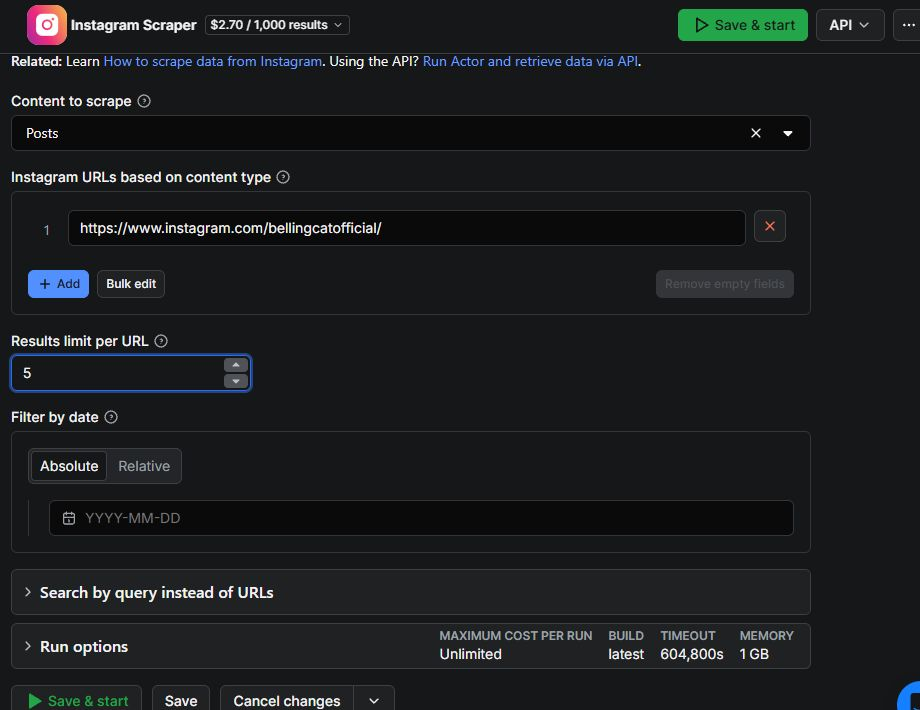

# Apify

## URL

[https://apify.com](https://apify.com)

## Description

Apify runs web scrapers on its servers. Its [Store](https://apify.com/store) offers ready-made programs called **Actors** for tasks such as collecting social media posts or extracting information from web pages. Many use a web form and export results as JSON, CSV or Excel, so a first collection need not involve programming.

For investigators, the appeal is practical: collect captions, dates, links and comments into a spreadsheet, then read more material side by side. Small, occasional jobs can be easier to arrange than setting up a local scraper. This entry draws on hands-on social media tests; each Actor's usefulness depends on what it returns for the task.

**Use the export to find material for closer inspection.** Open relevant posts, view their full media and read the surrounding discussion. Preserve sources with a dedicated archiving tool and check the saved capture. An Apify row or temporary media link does not preserve the source page.

**Using this entry.** Follow [Getting started](./#getting-started) for a first browser run, [From search terms to a review sheet](./#from-search-terms-to-a-review-sheet) for the investigative workflow, or [Tested Actors at a glance](./#tested-actors-at-a-glance) to choose a platform. Expand an Actor's example for settings, selected output, test dates and recorded costs.

### Choosing an Actor

Actors have different developers, prices and limits, even when they collect from the same website. Posts, comments and media downloads may require separate Actors or settings.

Check the sample output for the fields you need, then read the pricing, recent updates and reported issues. Check any request for login cookies or extra credentials. The Store identifies whether an Actor is [maintained by Apify or a community developer](https://docs.apify.com/actors/running/store/actor-developers).

<details>

<summary>How the data was obtained and what the tests cover</summary>

### How the data was obtained

An Actor's collection route determines what it can find. Search results, profile posts and comment threads expose different material:

| Route                                        | Actors and inputs in this entry                                                                                                                                                                   | What that means for review                                                                                                                                                  |
| -------------------------------------------- | ------------------------------------------------------------------------------------------------------------------------------------------------------------------------------------------------- | --------------------------------------------------------------------------------------------------------------------------------------------------------------------------- |
| X search                                     | API Dojo's Tweet Scraper uses `searchTerms`, including keywords, `from:` account queries and `url:` queries.                                                                                      | These are X search results. An account query is still a search, not a complete account archive. Ranking, indexing, filtering and pagination can omit posts.                 |
| A known X post or another search             | ScrapeBadger's tested modes were `Get Tweet by ID`, `Get Retweeters` and `Advanced Search` for queries containing source-post URLs.                                                               | A post lookup, a list of accounts and search results answer different questions. Searching for a URL does not by itself identify every quote or reply to that post.         |
| Facebook pages, groups and post URLs         | Posts and Groups Scrapers read supplied page/group URLs; a historical Posts Scraper test also retrieved a personal profile's posts. Comments Scraper reads post URLs; Search Scraper finds pages. | Page-name search is not a search of all Facebook post text. Profile access, group ordering and comment/reply settings affect what is available to read.                     |
| Instagram profiles and post URLs             | The tested configurations retrieve profile details, profile posts, individual posts or their comments.                                                                                            | First identify suitable profiles or post URLs. The profile's recent-post preview and a post's comment preview are not full timelines or threads.                            |
| TikTok hashtags, account search and profiles | Hashtag Scraper retrieves hashtag-associated videos; User Search Scraper returns candidate accounts; Profile Scraper and Comments Scraper take known targets.                                     | A text query in User Search searches accounts, not video captions. Hashtag results form a limited discovery set, not every video about a subject.                           |
| YouTube and Bluesky listings or searches     | YouTube uses supported channel, playlist or search inputs. Bluesky Actors offer post search and, depending on the mode, an author's feed.                                                         | A query or channel listing supplies a set of candidates; it does not demonstrate a complete historical collection. Comments and other record types need separate attention. |
| A C-SPAN programme page                      | The historical downloader used a supplied programme URL for audio links, programme metadata and a speaker list.                                                                                   | A participant list does not identify the speaker of each passage in a transcript.                                                                                           |

The [X Actor's documentation](https://apify.com/apidojo/tweet-scraper/input-schema) distinguishes `Top`, `Latest` and combined sorting. Keep the query and sort setting with the export. An empty result can reflect access or collection limits as well as absent content.

### What the testing covers

This entry covers **19 Actors** used by the page maintainer. Small tests on 15 September 2026 comprised **22 runs across 14 Actors**, with **$0.16746** in recorded usage charges on a Starter account. Earlier work adds Facebook search and Marketplace, two Bluesky Actors and a C-SPAN downloader. Saved run records, exports and notes establish what was retrieved; gaps in the surviving evidence are identified in the examples.

Expand an Actor's example for inputs, selected output and field explanations. **Excerpts omit fields and replace identifying text, IDs or temporary links with labelled placeholders.** They illustrate the returned structure; analyse the original export. Replace input placeholders with suitable public targets. Where current usage rules differ from a saved test, the example says so.

</details>

### Getting started

For a first browser run, request up to five posts from Bellingcat's public profile with [Instagram Scraper](https://apify.com/apify/instagram-scraper). The screenshots follow one saved five-post collection from 15 September 2026; the interface was captured on 30 October 2026.

1. Read the Actor's pricing and instructions, then choose **Try for free**. Sign in if prompted and open **Input** in Apify Console, where runs and results are managed.
2. In the form, enter the values below and leave **Filter by date** empty. Replace existing targets; **Bulk edit** lets you replace the URL list at once. The result limit applies to each URL.

The form and JSON editor supply the same input:

| Field in the form                    | Value for this example                          | JSON key       |
| ------------------------------------ | ----------------------------------------------- | -------------- |
| Content to scrape                    | Posts                                           | `resultsType`  |
| Instagram URLs based on content type | `https://www.instagram.com/bellingcatofficial/` | `directUrls`   |
| Results limit per URL                | `5`                                             | `resultsLimit` |

<figure><figcaption><p>The input form requests up to five posts from one public profile. Interface captured 30 October 2026.</p></figcaption></figure>

3. Set a maximum charge where available and check the account spending limit. A result cap is not a budget; optional features can add charges.
4. Choose **Start**, or **Save & start** after editing. This launches a chargeable run. Follow its status and log.
5. Open **Output**. Check for usable captions, dates and source URLs, as well as errors or partial records. A completed run can still contain failed lookups.
6. Choose **Export**. CSV or Excel suits spreadsheet reading; JSON retains nested data such as media objects. Keep the original JSON alongside your working sheet.
7. Open promising source posts, inspect their full media and discussion, then archive them. Record the capture location and any gaps in the sheet.

The Actor examples below supply JSON inputs for the Console's JSON editor. Python is optional.

Keep the collection date, Actor version (build), run ID and input with each export so you can trace how it was obtained. See the [running Actors guide](https://docs.apify.com/actors/running) for more on the Console.

<details>

<summary>See an example of the output and export controls</summary>

This saved run returned five posts with the walkthrough's settings. Repeating it later may return different posts.

<figure><figcaption></figcaption></figure>

_The retained five-post Instagram test, with Output selected and Export at the top right. Interface captured 30 October 2026._

Open nested cells such as “7 items” to see their contents, and scroll across to dates and URLs. Caption previews can be shortened; comment counts do not contain the comment texts.

<figure><figcaption></figcaption></figure>

_Export offers JSON, CSV and Excel among its formats; Excel is selected here. Interface captured 30 October 2026._

Choose a format and download the dataset.

**If the output looks unexpected**

| What you see                                  | First check                                                                                                                    |
| --------------------------------------------- | ------------------------------------------------------------------------------------------------------------------------------ |
| `SUCCEEDED`, but no usable content            | Open the dataset and inspect `error`, `status` and note fields. A completed run can contain only an error record.              |
| Fewer records than requested                  | Check the supplied target, dates, sort mode and access limits. The result limit is a maximum request, not a promised yield.    |
| A comment count larger than the export        | Check the comment cap and whether replies were enabled. The counter and the retrieved comment texts describe different things. |
| Empty media fields                            | Check the record type, nested carousel items and download settings before concluding that media is absent.                     |
| Duplicates or records lost during preparation | Compare source IDs before and after importing each export. Keep discovery queries and collection dates with duplicates.        |

</details>

<details>

<summary>Using the Actor examples from Python</summary>

[Apify's API](https://docs.apify.com/api/v2) accepts the same inputs. This adapted standard-library example starts a run, saves its ID, waits for completion and exports the dataset with its metadata.

Save an Actor's JSON input as `input.json`, set the `APIFY_TOKEN` environment variable to the token from the account's **API & Integrations** settings, and save the code as `collect.py`. For the five-post Instagram example, run:

```
python collect.py apify/instagram-scraper input.json
```

Running the script starts a collection and incurs the selected Actor's charges. Its run budget is set to $0.10; adjust it to the chosen Actor's pricing and minimum requirements.

```python
import json
import os
from pathlib import Path
import sys
import time
from urllib.parse import urlencode
from urllib.request import Request, urlopen

BASE = "https://api.apify.com/v2"
TOKEN = os.environ["APIFY_TOKEN"]
actor, input_file = sys.argv[1:3]
actor_input = json.loads(Path(input_file).read_text(encoding="utf-8"))

def api(method, path, body=None, **query):
    url = BASE + path
    if query:
        url += "?" + urlencode(query)
    payload = None if body is None else json.dumps(body).encode("utf-8")
    request = Request(url, data=payload, method=method, headers={
        "Authorization": "Bearer " + TOKEN,
        "Content-Type": "application/json",
    })
    with urlopen(request, timeout=120) as response:
        return json.load(response)

run = api("POST", "/actors/" + actor.replace("/", "~") + "/runs",
          actor_input, maxTotalChargeUsd=0.10, timeout=600)["data"]
folder = Path("apify-results") / run["id"]
folder.mkdir(parents=True, exist_ok=True)

def save(name, value):
    (folder / name).write_text(
        json.dumps(value, indent=2, ensure_ascii=False), encoding="utf-8")

save("input.json", actor_input)
save("run.json", run)  # Retain the run ID before waiting or downloading.
terminal = {"SUCCEEDED", "FAILED", "TIMED-OUT", "ABORTED"}
while run["status"] not in terminal:
    time.sleep(5)
    run = api("GET", "/actor-runs/" + run["id"])["data"]
    save("run.json", run)

dataset_id = run.get("defaultDatasetId")
count = 0
if dataset_id:
    with (folder / "items.ndjson").open("w", encoding="utf-8") as output:
        offset = 0
        while True:
            page = api("GET", "/datasets/" + dataset_id + "/items",
                       format="json", limit=1000, offset=offset)
            for item in page:
                output.write(json.dumps(item, ensure_ascii=False) + "\n")
            count += len(page)
            if len(page) < 1000:
                break
            offset += len(page)

run = api("GET", "/actor-runs/" + run["id"])["data"]
save("run.json", run)
print(run["status"], count, "records saved to", folder)
```

`items.ndjson` contains one JSON record per line. Exporting a dataset can also recover partial results from a failed or stopped run, so check both the run status and the records before analysis.

After an interruption, retrieve the saved run instead of starting another chargeable collection: replace the `POST` assignment with `run = api("GET", "/actor-runs/SAVED_RUN_ID")["data"]`, using the ID from `run.json`. Keep the Actor and input file consistent with that saved run. Stopping the local Python script does not stop the cloud run. If the interruption occurred before its ID was saved, check the Console's run history before starting again.

The run metadata contains the actual build and reported cost. In the saved tests, a cost read immediately after completion sometimes changed on a later read. Recheck billing before treating an early value as final; waiting a fixed number of seconds is not a guarantee. For more extensive automation, the [official Python client](https://docs.apify.com/api/client/python/) provides retry and dataset-iteration helpers.

</details>

### From search terms to a review sheet

Start with a research question and a few search terms. A Ceuta investigation's place-name matching lists included `Ceuta`, `Sebta`, `Sabta`, `Septa`, `سبتة`, `سبته` and `سبة`. Such variants can seed discovery, but need checking in context: a caption mentioning Ceuta does not locate the image or video there.

**1. Find candidates.** Search variants separately and retain each query. X searches posts; TikTok User Search finds accounts; TikTok Hashtag Scraper finds hashtag-associated videos. Inspect promising results and follow useful accounts, links or vocabulary.

**2. Collect posts and discussion.** Send selected profiles to a posts Actor, starting with a small limit and a date range where supported. Add comments from selected post URLs when the discussion matters. Keep comments linked to their parent post.

**3. Prepare a reading copy.** Keep the raw JSON, then arrange IDs, URLs, dates, original text and useful media fields in a spreadsheet. Separate errors and account records from posts. Remove duplicates while retaining discovery queries; keep all carousel items and attachments.

**4. Add translation.** Keep original and translated text side by side, with the method and review status. Have a competent language reader check consequential passages, especially names, numbers, negation and dialect. Agreement between machine translations does not establish accuracy.

**5. Inspect and preserve.** Use the sheet to choose what to read, watch and investigate further. Distinguish the uploader's claims from what the material establishes. Archive promising sources early with a tool such as [Auto Archiver](https://bellingcat.gitbook.io/toolkit/more/all-tools/auto-archiver) or [ArchiveWeb.page](https://archiveweb.page/), check the capture and record its location.

<details>

<summary>Worked pipeline: normalize exports, add translation and retain review context</summary>

**Raw exports → classify records → normalize and deduplicate → translate → join translations to posts → read in a spreadsheet.**

**A saved sample in Google Sheets.** This is the five-post Instagram export from Getting started. Full captions sit beside the returned account name, publication time and source URL. Other columns retain IDs, collection time and the original timestamp; collection notes identify the Actor, input and run.

<figure><figcaption></figcaption></figure>

_Selected columns from the five-post sample, prepared in Google Sheets. Captions and source URLs are preserved from the 15 September 2026 export. Interface captured 30 October 2026._

The returned `ownerUsername` names `evidentmediaorg` for one post. Check attribution rather than assuming every post belongs to the input profile. This sheet contains selected fields, not the complete media or source page.

Normalization means giving comparable fields consistent names and formats. The tested Actors use different names for the same basic information:

| Platform / tested output    | Post identifier       | Original text | Published time                 | Source link                                                               |
| --------------------------- | --------------------- | ------------- | ------------------------------ | ------------------------------------------------------------------------- |
| X / API Dojo posts          | `id`                  | `text`        | `createdAt`                    | `url`                                                                     |
| X / ScrapeBadger posts      | `id`                  | `full_text`   | `created_at`                   | Retain or reconstruct a post URL from `username` and `id`, then check it. |
| Facebook page / group posts | `postId` / `legacyId` | `text`        | `time`                         | `url`                                                                     |
| Instagram posts             | `id`                  | `caption`     | `timestamp`                    | `url`                                                                     |
| TikTok videos               | `id`                  | `text`        | `createTimeISO` / `createTime` | `webVideoUrl`                                                             |

First separate record types: posts, accounts, errors and notes. Some ScrapeBadger `status: "empty"` records contain an ID despite a failed lookup. Keep these in a collection-issues tab with their raw records. Retain usable fields from partial posts and flag the gaps. An empty caption alone does not invalidate an image or video post.

Identify duplicates by platform, record type and source ID. Retain their collection dates, queries and run references. Store IDs as text to prevent spreadsheet rounding. Convert dates to UTC while keeping the original value, record collection time separately and leave missing values empty rather than converting them to zero.

Join translations by the source key **and exact text version**: a caption can change while its post ID stays the same. Keep original text, language, translation, service and review status in separate columns. The implemented workflow uses [Ollama](https://docs.ollama.com/) and caches repeated text; check context before reusing a translation. Whether processing is local depends on the chosen model.

This **invented row illustrates the structure**, not a collected finding. The collection record would retain the Actor, build, run and raw-export references:

```json
{
  "platform": "tiktok",
  "record_type": "video",
  "post_id": "<VIDEO_ID>",
  "source_url": "<PUBLIC_POST_URL>",
  "published_at_utc": "<SOURCE_TIME_IN_UTC>",
  "collected_at_utc": "<COLLECTION_TIME_IN_UTC>",
  "discovery_queries": ["سبتة"],
  "original_text": "سبتة",
  "detected_language": "ar",
  "translation_en": "Ceuta",
  "translation_method": "machine; illustrative",
  "translation_review": "pending",
  "review_note": "Place-name mention; location unverified",
  "comments_status": "not_collected",
  "archive_status": "not_attempted"
}
```

The caption only names a place. It does not establish the video's location or event date. Translation disagreements can flag passages for review, but similarity scores can miss consequential differences. Keep unresolved language questions beside the full text.

Add decisions and reasons, unresolved questions, reviewer and review date. Use explicit statuses such as `not_collected`, `limited` or `failed` for comments and archives. Mark an archive as checked only after opening it and confirming the required media is present.

</details>

### Tested Actors at a glance

| Platform    | Starting task and follow-up                                                                                                                                    |
| ----------- | -------------------------------------------------------------------------------------------------------------------------------------------------------------- |
| X / Twitter | Search a term or source URL, read the returned posts, then retrieve selected posts or accounts for closer inspection.                                          |
| Facebook    | Identify public pages or groups, collect their posts, then retrieve comments from selected post URLs. Page search and Marketplace tests have their own limits. |
| Instagram   | Check a candidate profile, collect posts and inspect full carousels or videos, then add selected comment threads.                                              |
| TikTok      | Discover videos through hashtags or find accounts by name, collect selected profiles, then retrieve comments on relevant videos.                               |
| YouTube     | Collect metadata from a search, channel or playlist, then select videos to watch and preserve.                                                                 |
| Bluesky     | Search terms or links, inspect original threads, then consider an author's feed for follow-up.                                                                 |
| C-SPAN      | Historical example of retrieving programme audio and speaker metadata. The tested Actor is deprecated.                                                         |

The platform sections distinguish saved test output from instructions adapted to current documentation. Costs in the examples are historical usage charges in US dollars, not current quotes or subscription prices.

### X / Twitter

**A typical workflow:** search a keyword, spelling variant or article URL with Tweet Scraper. Read the returned posts, then use ScrapeBadger to retrieve selected posts by ID, search for links to them or inspect retweeter accounts.

#### Tweet Scraper — API Dojo

[`apidojo/tweet-scraper`](https://apify.com/apidojo/tweet-scraper) collects X **search results**, including keyword, `from:` and `url:` queries. An account query does not produce a complete timeline. Splitting searches improved retrieval in the tests, but still missed posts. No X login was required. Ordinary use requires requesting at least 50 results per query and excludes single-post, conversation and reply collection; check the usage rules before choosing it.

<details>

<summary>Search inputs, example output and lessons from larger collections</summary>

**Configure a search.** Open the Actor's Input tab and supply one query initially. This example adapts the saved keyword input by increasing `maxItems` from 10 to 50:

```json
{
  "searchTerms": ["Bellingcat"],
  "sort": "Latest",
  "maxItems": 50,
  "includeSearchTerms": true
}
```

The developer currently requires at least 50 results per query for ordinary use, permits one simultaneous run with up to five queries, and prohibits single-post, conversation and reply collection through this Actor. Queries likely to return fewer results need a different Actor. The Free-plan demonstration has separate limits: five runs per month, capped at ten items each. These restrictions take precedence over examples from earlier collections. See the [Actor's usage instructions](https://apify.com/apidojo/tweet-scraper).

For account posts, change the query to `from:bellingcat`. For posts sharing a website, use a query such as `url:bellingcat.com`. Date operators such as `since:2026-01-01 until:2026-09-01` can narrow the search, but inspect the returned dates before relying on the requested interval. `maxItems` limits the whole run: batching several queries does not give each one that allowance.

**Observed output.** The saved ten-result keyword run on 15 September 2026 used build `0.0.1518` and cost $0.004. It predates this adaptation of the example input. Selected fields from one returned post:

```json
{
  "type": "tweet",
  "id": "<post ID>",
  "url": "<source post URL>",
  "text": "<post text omitted>",
  "createdAt": "Tue Sep 15 08:28:05 +0000 2026",
  "likeCount": 0,
  "retweetCount": 0,
  "replyCount": 0,
  "viewCount": 11,
  "author": {
    "id": "<author ID>",
    "userName": "<author handle>",
    "followers": 220,
    "following": 226
  }
}
```

The post ID connects records from overlapping searches; the author ID connects posts by the same account. Follower and view counts describe the collection time, not necessarily the audience when the post was published. A separate five-post account query also returned usable records.

**Practical findings.** In a March 2026 test, splitting a historical collection into 208 queries covering shorter periods returned 7,406 unique post IDs, compared with 3,506 from six earlier runs. However, 651 IDs from the earlier collection were absent from the segmented collection. Combining the exports preserved 8,057 unique posts. Smaller queries improved retrieval in that test without making either collection complete.

A separate search based on known media URLs found 1,385 matching posts. This illustrates a useful investigative approach: an article or video link can find discussion that does not mention the person or organisation being researched. Keep the query with each record and check the actual outgoing links before treating a result as a match.

Compared with a locally tested `twscrape` 0.20.0 setup, Apify avoided the need to maintain X login sessions. With no active accounts, that `twscrape` setup returned no posts without raising an exception. This was an access-configuration difference, not evidence that the search had no results. [twscrape](https://github.com/vladkens/twscrape) remains an open-source option for researchers prepared to manage those accounts.

</details>

#### X Tweet Scraper — ScrapeBadger

[`scrape.badger/twitter-tweets-scraper`](https://apify.com/scrape.badger/twitter-tweets-scraper) retrieved known posts, URL-search results and retweeter accounts. Its reply and native quote modes were not verified. Current setup requires a separate **ScrapeBadger API key**, with that service's charges as well as Apify's; the saved tests predate this requirement.

<details>

<summary>Retweeter accounts, URL searches and retrieval of a known post</summary>

**Configure the collection.** Select **Get Retweeters**, enter the numeric ID from the end of the source post's URL, and set **Max Results**. The following is the saved input structure with the post ID replaced:

```json
{
  "mode": "Get Retweeters",
  "id": "REPLACE_WITH_POST_ID",
  "max_results": 20
}
```

The September test ran with an Apify token and no separately supplied ScrapeBadger key. The [current setup instructions](https://apify.com/scrape.badger/twitter-tweets-scraper) additionally tell users to add `SCRAPEBADGER_API_KEY` under the Actor's **Settings → Environment variables** and mark it secret. Check that requirement and the associated service's charges before repeating the test. It is distinct from an X developer API key.

**Observed output.** Build `1.4.20` returned 14 account records from the twenty-result request; the recorded charge was $0.00196. Selected fields from one account:

```json
{
  "id": "<account ID>",
  "username": "<account handle>",
  "name": "<display name>",
  "followers_count": 0,
  "following_count": 62,
  "tweet_count": 2,
  "verified": false,
  "protected": false
}
```

This is an account record, not a repost event with its own timestamp. Save the queried post ID alongside every returned account so that the relationship remains clear after exports are combined. To examine what somebody wrote, read the linked source and relevant response posts; the URL-search example below can help find some of that discussion. A list of accounts cannot answer that question.

Fourteen returned records do not establish that only fourteen accounts ever reposted the source. Deleted accounts, removed interactions and retrieval limits can affect the available list. Likewise, a repost alone does not establish agreement or coordination. The historical collections below also document Advanced Search and Get Tweet by ID.

**Advanced Search: find discussion linking to a source post**

Searching for a known post's URL can collect commentary that links back to it. This gives a manageable set of posts to read alongside the original, compare interpretations and select material to preserve. The Actor's `Advanced Search` mode was used for this in two January 2026 collections; the saved run records contain both the search input and the resulting datasets.

Select **Advanced Search**. Replace `REPLACE_WITH_POST_ID` with a public Bellingcat post's numeric ID, or change both the account name and ID to another relevant public source. This input adapts the saved query structure with a neutral target and a smaller result limit; the historical collections requested up to 1,000 results per query.

```json
{
  "mode": "Advanced Search",
  "query": "(https://twitter.com/bellingcat/status/REPLACE_WITH_POST_ID OR https://x.com/bellingcat/status/REPLACE_WITH_POST_ID) -from:bellingcat -filter:retweets -filter:replies",
  "query_type": "Latest",
  "max_results": 20
}
```

The two URL forms account for links using either platform domain. The exclusions ask the search to omit posts by the source account, reposts and replies. They express the search request; review the returned records to establish what was actually collected. A keyword or article URL can also be entered as a search query, using the Actor's supported syntax. See the [ScrapeBadger instructions](https://apify.com/scrape.badger/twitter-tweets-scraper).

Selected fields from a saved post returned by the historical URL search:

```json
{
  "id": "REDACTED_POST_ID",
  "username": "REDACTED_USERNAME",
  "full_text": "[Post text redacted]",
  "created_at": "Thu Jun 26 18:28:53 +0000 2025",
  "is_quote_status": true,
  "quoted_status_id": "REDACTED_QUOTED_POST_ID",
  "is_retweet": false,
  "favorite_count": 1,
  "reply_count": 0,
  "view_count": 53
}
```

One 55-query batch returned 1,022 posts and 46 empty-result records. Seven of those posts had `is_quote_status: false`. In a second, 104-query batch, only ten of the 75 returned posts were marked as quotes. These were **URL searches**, not tests of the Actor's separate **Get Quotes** mode. Check `quoted_status_id`, the linked URL and the visible post before labelling an item as a quote of the source. Read the accompanying text to distinguish endorsement, criticism or an incidental reference.

The empty records used this structure:

```json
{
  "status": "empty",
  "reason": "no_results",
  "mode": "Advanced Search",
  "query": "[Search query redacted]"
}
```

Separate these status records before counting posts. Save the query and collection date with the export, then preserve the original and relevant response posts with their surrounding context. An empty search result does not establish that nobody discussed the source.

**Get Tweet by ID: retrieve a known post for review**

Use **Get Tweet by ID** when a post has already been identified through a link, a document or another collection. Its structured record can put the text, date, author and available engagement fields into a review table without a broader search. A January 2026 collection preserved 21 raw post records from this mode; the collector and its methodology report identify the mode, although individual Apify run IDs were not retained.

Copy the numeric part after `/status/` in a public post URL into `id`:

```json
{
  "mode": "Get Tweet by ID",
  "id": "REPLACE_WITH_POST_ID"
}
```

Selected observed fields from that historical collection:

```json
{
  "id": "REDACTED_POST_ID",
  "username": "REDACTED_USERNAME",
  "full_text": "[Post text redacted]",
  "created_at": "Fri Dec 02 23:34:32 +0000 2022",
  "lang": "en",
  "view_count": null,
  "is_quote_status": false,
  "is_retweet": false
}
```

`view_count: null` means no view count was returned, not zero views. The saved response also includes links and media fields for following up the post.

</details>

### Facebook

**A typical workflow:** find and check public pages or groups, collect their posts, then send relevant post URLs to Comments Scraper. Keep comments in a sheet linked to the parent posts. Search Scraper can suggest pages, but its matches need checking.

#### Facebook Posts Scraper

[`apify/facebook-posts-scraper`](https://apify.com/apify/facebook-posts-scraper) collects page posts, dates, links and engagement. The page test worked without Facebook credentials. A historical personal-profile lookup also worked, although current documentation gives conflicting guidance on profile support; test that use separately.

<details>

<summary>Page posts, their links and a historical personal-profile test</summary>

**Historical test results.** The maintainer's 15 September 2026 test returned five posts for $0.021, without supplying Facebook credentials. Earlier testing included a successful personal-profile lookup and recorded 186 items across nine runs for $0.755.

This input uses Bellingcat's public page and preserves the settings used in the September test. Substitute another public page URL for a different target:

```json
{
  "startUrls": [{"url": "https://www.facebook.com/bellingcat"}],
  "resultsLimit": 5,
  "captionText": false
}
```

**Selected output:**

```json
{
  "postId": "<POST_ID>",
  "pageName": "<PAGE_HANDLE>",
  "url": "<POST_PERMALINK>",
  "time": "2026-09-14T15:10:04.000Z",
  "text": "<POST_TEXT>",
  "link": "<EXTERNAL_LINK>",
  "likes": 16,
  "shares": 1,
  "media": [
    {
      "__typename": "Photo",
      "thumbnail": "<MEDIA_URL>",
      "ocrText": "<IMAGE_TEXT_DESCRIPTION>"
    }
  ]
}
```

`postId` and the permalink help deduplicate overlapping runs and return to the original post. `time` is the publication timestamp; the engagement figures are observations at collection time. `ocrText` provides a textual description associated with an image and needs checking against the image before quotation. The separate `textReferences` array can contain several external links even when `link` contains only one.

The tested input disabled video-transcript extraction. The [input documentation](https://apify.com/apify/facebook-posts-scraper/input-schema) also provides newer-than and older-than date filters. Check their pricing before adding them. The Store description advertises profile support, while the input documentation restricts collection to public pages. The historical profile result below documents access at that time without resolving what today's build will retrieve.

**Historical personal-profile lookup.** On 12 August 2026, build `0.0.365` returned two post records from a personal-profile URL. This is the saved input, with the profile ID replaced:

```json
{
  "startUrls": [{"url": "https://www.facebook.com/profile.php?id=<PUBLIC_PROFILE_ID>"}],
  "resultsLimit": 100,
  "captionText": false,
  "onlyPostsNewerThan": "2026-06-01"
}
```

The request allowed up to 100 posts after the specified date; receiving two does not establish a complete history. **Selected output:**

```json
{
  "postId": "<POST_ID>",
  "url": "<POST_URL>",
  "text": "<POST_TEXT>",
  "likes": 11,
  "comments": 1,
  "shares": 0
}
```

`comments: 1` is a count. Send the permalink to Comments Scraper to retrieve comment text.

</details>

#### Facebook Groups Scraper

[`apify/facebook-groups-scraper`](https://apify.com/apify/facebook-groups-scraper) collects posts from known public groups. The sample returned old posts, and larger exports included duplicates and errors. Check dates and ordering before treating an export as a recent group history.

<details>

<summary>Example: collect public-group posts in chronological order</summary>

**Historical test results.** The September test requested three posts and returned two for $0.009. An earlier billing audit recorded 52 group runs costing $13.45; the saved datasets contained 2,705 items, including repeated posts and error records.

Use the URL of a public group already identified during research:

```json
{
  "startUrls": [{"url": "<PUBLIC_FACEBOOK_GROUP_URL>"}],
  "resultsLimit": 3,
  "viewOption": "CHRONOLOGICAL"
}
```

Adapted excerpt from a returned post:

```json
{
  "url": "<GROUP_POST_PERMALINK>",
  "time": "2020-11-05T11:50:27.000Z",
  "user": {"id": "<AUTHOR_ID>", "name": "<AUTHOR_NAME>"},
  "text": "<POST_TEXT>",
  "legacyId": "<POST_ID>",
  "likesCount": 0,
  "sharesCount": 0,
  "commentsCount": 0,
  "groupTitle": "<GROUP_TITLE>"
}
```

The old publication date is a real feature of this sample: a successful run did not establish that the group was recently active. Two returned posts against a limit of three also illustrate that a limit is a maximum request, not a promised yield.

The [current input documentation](https://apify.com/apify/facebook-groups-scraper/input-schema) says the result limit applies to the “New posts” sorting option, represented by `CHRONOLOGICAL`. Other sorting modes select different material. A newer-than filter can narrow collection, but the schema does not offer an equivalent older-than field.

In the earlier collection, unavailable groups sometimes produced an error item inside a successful run and were charged as results. Count actual posts after checking for errors. Group records use names such as `likesCount` and `legacyId`, whereas page-post records use `likes` and `postId`; a shared importer must account for these differences.

**Earlier workflow.** The August working collection contained 1,788 deduplicated posts from seven groups and 1,050 comments from 95 threads. A later browser refresh on 17 August collected 165 posts from eight groups, with stable permalinks for 18 posts. That refresh used a logged-in browser and did not expand comment threads. Different dates, targets and collection methods prevent a direct comparison; preserve those differences when describing what was available to inspect.

</details>

#### Facebook Comments Scraper

[`apify/facebook-comments-scraper`](https://apify.com/apify/facebook-comments-scraper) collects public comments and, optionally, replies from individual post URLs. The tests retrieved a reel discussion but also returned billed error records for other post URLs.

<details>

<summary>Example: collect comments, and recognise a billed empty result</summary>

**Historical test results.** In September, two page-post URLs returned error records, while a reel URL returned 11 comments/replies for $0.023. Earlier testing recorded 1,234 items across 132 runs for $3.365.

This is the successful reel test's input with its URL replaced:

```json
{
  "startUrls": [{"url": "<PUBLIC_FACEBOOK_REEL_URL>"}],
  "resultsLimit": 5,
  "includeNestedComments": true,
  "viewOption": "RANKED_UNFILTERED"
}
```

Adapted excerpt from one returned comment:

```json
{
  "commentUrl": "<COMMENT_PERMALINK>",
  "commentId": "<COMMENT_ID_FIELD>",
  "date": "2026-09-11T23:14:06.000Z",
  "text": "<COMMENT_TEXT>",
  "profileName": "<COMMENTER_NAME>",
  "likesCount": "2",
  "commentsCount": 4,
  "threadingDepth": 0
}
```

`likesCount` arrived as a string, so numerical analysis requires conversion. `threadingDepth` helps distinguish comments from replies. Check the relationship between `commentId`, `id` and `commentUrl` before choosing a deduplication key: the maintainer encountered replies whose `commentId` referred to the parent.

With nested comments enabled, the five-result request returned 11 records. The [documentation](https://apify.com/apify/facebook-comments-scraper/input-schema) supports up to three comment levels; replies can increase the output beyond the selected limit.

Both tested `/posts/pfbid…` URLs instead returned this adapted error record:

```json
{
  "inputUrl": "<PUBLIC_FACEBOOK_POST_URL>",
  "error": "no_items",
  "errorDescription": "Empty or private data for provided input"
}
```

The saved records show why both levels need inspection:

| Saved record                        | What it shows                                                  |
| ----------------------------------- | -------------------------------------------------------------- |
| Run metadata: `status: "SUCCEEDED"` | The Actor finished executing.                                  |
| Dataset item: `error: "no_items"`   | That run retrieved an error record instead of usable comments. |

Each run ended `SUCCEEDED` and cost $0.003. This small test does not establish a general fault with that URL format. Test representative URLs before a larger collection, and distinguish “nothing retrieved” from “no comments exist”.

</details>

#### Facebook Search Scraper

[`apify/facebook-search-scraper`](https://apify.com/apify/facebook-search-scraper) finds **pages, not post text**. The saved test returned other pages instead of the intended target. Check identity and relevance before collecting their posts.

<details>

<summary>Historical example: a page search that returned nonmatching results</summary>

**Historical test results.** A historical test on 12 August 2026 attempted to resolve a page name, returned four other pages, and cost $0.049. It did not resolve the intended target.

The saved run input, with the search term replaced:

```json
{
  "categories": ["<PAGE_NAME_TO_FIND>"],
  "locations": [],
  "resultsLimit": 20
}
```

Despite its name, `categories` accepts search keywords. `locations` can add a city, region or country; this test left it empty. The [current schema](https://apify.com/apify/facebook-search-scraper/input-schema) defines `resultsLimit` across the entire run.

**Selected output:**

```json
{
  "pageId": "<RETURNED_PAGE_ID>",
  "pageName": "<RETURNED_PAGE_HANDLE>",
  "pageUrl": "<RETURNED_PAGE_URL>",
  "title": "<RETURNED_PAGE_TITLE>",
  "intro": "<PAGE_DESCRIPTION>",
  "followers": 23778179,
  "followings": 10,
  "websites": ["<MAP_LINK>", "<WEBSITE_LINK>"]
}
```

These are page-level records, not matching posts or evidence that a page belongs to the subject of a search. The saved dataset included websites and public contact fields, but the returned pages did not resolve the requested name. Inspect identity and relevance before treating results as a discovery.

The saved run record initially showed $0.025; a later billing audit recorded $0.049. That difference is a practical reason to distinguish an immediate cost reading from settled charges.

</details>

#### Facebook Marketplace Scraper

[`apify/facebook-marketplace-scraper`](https://apify.com/apify/facebook-marketplace-scraper) can retrieve listings and optional details for investigating advertised items. The only saved test retrieved no usable listing details; successful collection was not demonstrated.

<details>

<summary>Historical example: a listing URL returned no usable listing</summary>

**Historical test results.** The maintainer's only recorded test, on 12 August 2026, returned an error record instead of listing details and cost $0.005.

The actual input, with the listing identifier replaced:

```json
{
  "startUrls": [
    {"url": "https://www.facebook.com/marketplace/item/<LISTING_ID>/"}
  ],
  "resultsLimit": 1,
  "includeListingDetails": true
}
```

The saved output contained one item:

```json
[
  {
    "url": "<MARKETPLACE_LISTING_URL>",
    "error": "no_items",
    "errorDescription": "Empty or private data for provided input"
  }
]
```

The error fields are unchanged. Despite `SUCCEEDED`, the run retrieved no price, description or seller details. It does not establish whether the listing existed.

The [schema](https://apify.com/apify/facebook-marketplace-scraper/input-schema) accepts Marketplace URLs. `includeListingDetails` adds description, coordinates, timestamps and attributes as an extra data package. The failed test already used a full URL; no working fix was demonstrated.

The saved run record initially showed zero cost, while the later billing audit recorded $0.005.

</details>

### Instagram

**A typical workflow:** check candidate accounts with Profile Scraper, then collect their posts with Instagram Scraper. Read captions, open full carousels or videos, and add comments for selected posts. Post Scraper retrieves details when you already have individual post URLs.

#### Instagram Scraper

[`apify/instagram-scraper`](https://apify.com/apify/instagram-scraper) was tested for profile posts and profile details. Posts include captions, dates and URLs, with carousel media nested under the main record. Comment previews are limited; use Comments Scraper for discussion. Larger exports mixed usable posts, partial records and failed lookups.

<details>

<summary>Profile posts, carousel contents and the tested profile-details mode</summary>

**Historical test results.** The September test returned five posts from a public profile for $0.0115. Earlier testing recorded 5,417 items across four runs for $12.4591; that is an item total, not a deduplicated count of posts.

This example uses Bellingcat's public Instagram profile. Use `posts` for a feed; change the content type only after checking that the supplied URL matches it:

```json
{
  "directUrls": ["https://www.instagram.com/bellingcatofficial/"],
  "resultsType": "posts",
  "resultsLimit": 5,
  "addParentData": false
}
```

Adapted excerpt from a returned carousel:

```json
{
  "id": "<POST_ID>",
  "type": "Sidecar",
  "caption": "<POST_CAPTION>",
  "url": "<POST_URL>",
  "timestamp": "2026-09-11T16:31:29.000Z",
  "likesCount": 374,
  "commentsCount": 6,
  "videoViewCount": null,
  "childPosts": [
    {
      "id": "<CAROUSEL_ITEM_ID>",
      "type": "Image",
      "displayUrl": "<MEDIA_URL>",
      "likesCount": null
    }
  ]
}
```

`Sidecar` denotes a carousel. Only one child is shown here. `childPosts` lets an investigator inspect its component images; a null child engagement value is not zero. The full record also included `latestComments`, which is a comment preview rather than assurance of a complete thread.

In the retained output table, select the **7 items** cell under **Child Posts** to inspect the nested array. Each child has its own identifier, type and media fields. Open and preserve all relevant carousel items; reading only the parent caption or saving one thumbnail can miss material.

<figure><figcaption></figcaption></figure>

_One carousel is one parent post with seven child records. The expanded cell exposes their separate fields. Interface captured 30 October 2026 from the retained September sample._

A different handle tested that day returned `error: "no_items"` and was charged $0.0023. Check the precise account URL before scaling up; an empty result alone does not distinguish an empty, private or inaccessible account.

The [current documentation](https://apify.com/apify/instagram-scraper) says there is no fixed overall retrieval cap: availability depends on the content and what Instagram exposes. `resultsLimit` applies per URL. Set a limit for the intended collection and compare the returned coverage with known posts. Date filters use UTC, and pinned posts can affect ordering and filtering.

**Earlier post collection.** On 11 August 2026, one run returned 5,289 items in eight minutes and 12 seconds: 5,285 post records, including one with a partial-data error, and four failed lookups. Its recorded cost was approximately $12.16. Those are returned records, not a deduplicated count of complete posts.

**Profile-details mode.** The same Actor was also used with `resultsType: "details"` to inspect profile IDs, biographies, account status and other account information. This is a reconstructed, reduced input from the historical collection script; the original run input was not retained:

```json
{
  "directUrls": [
    "https://www.instagram.com/<PUBLIC_USERNAME_A>/",
    "https://www.instagram.com/<PUBLIC_USERNAME_B>/",
    "https://www.instagram.com/<PUBLIC_USERNAME_C>/"
  ],
  "resultsType": "details",
  "resultsLimit": 1
}
```

Replace the usernames with suitable public targets. This requests profile details, not a subject search or the accounts' full post histories. The historical enrichment export contained 121 items: 110 unflagged profiles, two profiles marked as restricted, and nine error-only records. An earlier six-item probe contained two profiles and four errors; a retry returned one error.

**Selected output from three records in the 121-item export:**

```json
[
  {
    "inputUrl": "<PROFILE_A_URL>",
    "id": "<PROFILE_A_ID>",
    "username": "<PUBLIC_USERNAME_A>",
    "private": false,
    "postsCount": 1231
  },
  {
    "inputUrl": "<PROFILE_B_URL>",
    "id": "<PROFILE_B_ID>",
    "username": "<PUBLIC_USERNAME_B>",
    "private": false,
    "error": "Restricted profile",
    "isRestrictedProfile": true
  },
  {
    "url": "<PROFILE_C_URL>",
    "username": "<PUBLIC_USERNAME_C>",
    "error": "not_found"
  }
]
```

`postsCount` is the profile's reported post count, not the number retrieved in this request. The restricted record retains an ID but is partial. The `not_found` record supplies an error instead of a profile ID; that label alone does not prove deletion. Retain usable fields and their error flags, and treat any nested `latestPosts` as a preview. This mode belongs to Instagram Scraper; the separate Instagram Profile Scraper below was tested independently.

</details>

#### Instagram Profile Scraper

[`apify/instagram-profile-scraper`](https://apify.com/apify/instagram-profile-scraper) retrieves account details and a recent-post preview. It helped check candidate accounts and resolve handle spelling errors in the tests. The preview is not a full timeline.

<details>

<summary>Example: inspect a profile before collecting its timeline</summary>

**Historical test results.** The September test returned one profile, including 12 recent posts, for $0.0023. An earlier 16-profile output included 108 recent posts for a settled $0.0368, making it useful for assessing accounts before commissioning deeper timeline collection.

This input uses the same public institutional account as the posts example:

```json
{
  "usernames": ["bellingcatofficial"],
  "includeAboutSection": false
}
```

Selected profile fields and one recent post, adapted from the September output:

```json
{
  "id": "<PROFILE_ID>",
  "username": "<PROFILE_USERNAME>",
  "biography": "<PROFILE_BIOGRAPHY>",
  "externalUrl": "<PROFILE_EXTERNAL_LINK>",
  "followersCount": 87194,
  "followsCount": 67,
  "postsCount": 326,
  "private": false,
  "verified": false,
  "latestPosts": [
    {
      "id": "<RECENT_POST_ID>",
      "caption": "<POST_CAPTION>",
      "timestamp": "2026-09-14T15:56:12.000Z",
      "likesCount": 194,
      "commentsCount": 7
    }
  ]
}
```

`postsCount` describes the profile's reported total; `latestPosts` contains only recent content, with one of the 12 returned posts shown above. It should not be mistaken for the whole timeline. Follower counts are collection-time observations, not historical counts at the publication time of each post.

The test disabled `includeAboutSection`. The [current input documentation](https://apify.com/apify/instagram-profile-scraper/input-schema) describes that option as a paid feature for additional account information. Do not expect join-date or country information from this tested configuration, and do not infer the operator's physical location from an account label.

</details>

#### Instagram Comments Scraper

[`apify/instagram-comment-scraper`](https://apify.com/apify/instagram-comment-scraper) retrieves comments from post or reel URLs, with optional replies. The sample returned the requested ten comments from a post reporting 112. Set the cap and reply options to suit the discussion you need to read.

<details>

<summary>Example: collect a bounded sample of comments</summary>

```json
{
  "directUrls": ["<PUBLIC_INSTAGRAM_POST_URL>"],
  "resultsLimit": 10,
  "includeNestedComments": false
}
```

**Historical test results.** The September test returned ten comments for $0.023. A historical multi-post test returned 595 comments for $1.3685, with replies disabled and a limit of 50 comments per post.

Adapted excerpt from one returned comment:

```json
{
  "postUrl": "<POST_URL>",
  "commentUrl": "<COMMENT_URL>",
  "id": "<COMMENT_ID>",
  "text": "<COMMENT_TEXT>",
  "ownerUsername": "<COMMENTER_USERNAME>",
  "timestamp": "2026-09-02T12:26:41.000Z",
  "repliesCount": null,
  "replies": null,
  "likesCount": 0,
  "owner": {"id": "<COMMENTER_ID>", "is_verified": false}
}
```

`resultsLimit` is per supplied URL. This test's null reply fields do not establish that replies were absent: reply extraction was disabled. The [current schema](https://apify.com/apify/instagram-comment-scraper/input-schema) makes nested replies available to paying users and says they produce additional result rows beyond the comment limit.

The same post's detailed record reported 112 comments, while this request intentionally retrieved ten. A bounded sample can help assess language, field structure or likely relevance, but it cannot establish complete participation, the absence of a commenter, or the full timing of a conversation. Those questions require an explicit assessment of coverage and reply handling.

Retain comment IDs for deduplication and the collection timestamp separately from each comment's publication timestamp. The account ID describes the author attached to the returned record; it does not identify the person operating that account.

</details>

#### Instagram Post Scraper

[`apify/instagram-post-scraper`](https://apify.com/apify/instagram-post-scraper) retrieves posts supplied directly by URL, or posts from profiles. Direct URLs are useful when checking a specific image or video cited elsewhere. The tested detailed output exposed separate video and audio links, which need checking when saving media.

<details>

<summary>Example: retrieve one post with media and timing details</summary>

**Historical test results.** The September detailed-data test returned one video post for $0.0023, with both a post and a post-details charge recorded.

The input field is named `username`, but also accepts post URLs:

```json
{
  "username": ["<PUBLIC_INSTAGRAM_POST_URL>"],
  "resultsLimit": 1,
  "dataDetailLevel": "detailedData"
}
```

Adapted excerpt from the saved output:

```json
{
  "id": "<POST_ID>",
  "type": "Video",
  "caption": "<POST_CAPTION>",
  "timestamp": "2026-08-27T10:46:41.000Z",
  "dimensionsHeight": 1920,
  "dimensionsWidth": 1080,
  "videoDuration": 111.366669,
  "videoUrl": "<VIDEO_URL>",
  "audioUrl": "<AUDIO_URL>",
  "likesCount": 4614,
  "commentsCount": 112,
  "videoViewCount": null,
  "videoPlayCount": 133155
}
```

The duration is in seconds. This record exposes video and audio URLs separately: verify the downloaded file's audio rather than assuming every video URL provides a complete audiovisual copy. `videoViewCount` is null while `videoPlayCount` contains a value; preserve that distinction rather than silently substituting one measure for the other.

The [current schema](https://apify.com/apify/instagram-post-scraper/input-schema) says `resultsLimit` controls posts per profile and does not apply to direct post URLs. For a small direct-URL test, limit the number of supplied URLs. `detailedData` incurs an additional charge.

An earlier request supplied 20 post URLs and returned 20 items for $0.046, including unsuccessful lookups. A returned row therefore cannot be counted automatically as a retrieved post. The successful September example shows what was actually available for one public video, not a guarantee that every post exposes the same fields.

</details>

### TikTok

**A typical workflow:** discover videos through hashtag variants or find accounts with User Search. Review the candidates, collect selected profiles, then pass relevant videos' `webVideoUrl` values to Comments Scraper as `postURLs`. Read captions, available subtitles and comments alongside the videos. The examples leave media downloads off.

The four Clockworks Actors below are maintained by Apify. The tests supplied no TikTok login or session cookie.

#### TikTok Profile Scraper

[TikTok Profile Scraper](https://apify.com/clockworks/tiktok-profile-scraper) collects account videos, captions, dates and audio metadata. Existing subtitle links appeared even with downloads off; generating a new transcription is a separate option. Private-profile responses and errors can be billed, so count usable videos after checking the records.

<details>

<summary>Profile videos: tested input, selected output and a billed private-profile response</summary>

**Historical test results.** The September test used build `0.0.477`. A public news account returned three videos for **$0.006**. A separate handle returned one item marked **Profile is private**, charged at **$0.002**. The earlier collection recorded 11 runs, 1,120 returned items and **$3.129** in charges. Those items comprised 969 video rows, 119 errors and 32 notes; the video rows represented 957 distinct video IDs. Separating these record types avoids mistaking profile checks and failed lookups for videos available to review.

**Input.** This is the three-video sample's input, using the BBC News account. `resultsPerPage` controls the number of posts per profile. This sample requested the videos section, sorted by latest, with media downloads and transcription disabled. Replace `bbcnews` to examine another public account.

```json
{
  "profiles": ["bbcnews"],
  "resultsPerPage": 3,
  "profileScrapeSections": ["videos"],
  "profileSorting": "latest",
  "excludePinnedPosts": false,
  "shouldDownloadVideos": false,
  "shouldDownloadCovers": false,
  "shouldDownloadSlideshowImages": false,
  "downloadSubtitlesOptions": "NEVER_DOWNLOAD_SUBTITLES"
}
```

**Selected output, one of three videos:**

```json
{
  "id": "<VIDEO_ID>",
  "text": "<CAPTION_OMITTED>",
  "createTimeISO": "2026-09-15T10:10:05.000Z",
  "webVideoUrl": "<PUBLIC_VIDEO_URL>",
  "authorMeta": {
    "id": "<AUTHOR_ID>",
    "name": "<PROFILE_HANDLE>",
    "verified": true,
    "privateAccount": false,
    "fans": 16300000
  },
  "musicMeta": {
    "musicId": "<SOUND_ID>",
    "musicOriginal": true
  },
  "videoMeta": {
    "duration": 87,
    "subtitleLinks": [{
      "language": "eng-US",
      "downloadLink": "<SIGNED_SUBTITLE_URL_OMITTED>",
      "source": "ASR"
    }],
    "transcriptionLink": null
  },
  "diggCount": 411,
  "playCount": 28600,
  "shareCount": 5,
  "commentCount": 9,
  "collectCount": 12,
  "isPinned": false,
  "mediaUrls": []
}
```

`diggCount` counts likes, `playCount` counts plays and `authorMeta.fans` counts followers at collection. `commentCount: 9` does not contain nine comment texts. Here, `mediaUrls: []` reflects disabled downloading, not absent video. Retain `musicMeta.musicId` to find videos using the same sound, then inspect them in context.

**The private-profile response.** A separate run requested up to five videos and returned this type of item instead:

```json
{
  "authorMeta": {
    "id": "<OTHER_AUTHOR_ID>",
    "name": "<OTHER_PROFILE_HANDLE>",
    "privateAccount": true,
    "video": 0
  },
  "input": "<OTHER_PROFILE_HANDLE>",
  "note": "Profile is private"
}
```

The run was `SUCCEEDED`, and its ledger charged one result. This records what the Actor could retrieve; it does not establish that the account has never posted. Separate these responses from video records when counting results.

**Subtitles and transcription.** TikTok-provided automatic speech recognition links appeared with subtitle downloading off. Both September runs recorded zero `transcription-minute` charges. The [input options](https://apify.com/clockworks/tiktok-profile-scraper/input-schema) distinguish downloading existing subtitles from paying for new transcription. A null `transcriptionLink` does not establish that subtitles are absent.

The historical collection saved 1,241 existing TikTok subtitle tracks and generated 930 additional TikTok transcripts locally. That supported a useful sequence: inspect available subtitle tracks first, then transcribe missing speech where needed. Automatically generated subtitles still need checking against the audio. Signed links can expire; the earlier collection encountered expired cover links about two days after capture.

**What the earlier collection added.** A low-volume check of 132 candidate handles cost about $0.22 and found little support for transferring handles from another platform, avoiding a larger planned scrape. For accounts already identified, a separate `yt-dlp` workflow collected 351 rows of newly found posts without an Apify charge. These were different collection stages: the Actor helped establish and inspect the account list, while the local workflow refreshed known accounts.

</details>

#### TikTok Hashtag Scraper

[TikTok Hashtag Scraper](https://apify.com/clockworks/tiktok-hashtag-scraper) discovers videos and authors when relevant accounts are not yet known. Results are a limited discovery set, not every video about a subject. The historical collection supplied accounts for follow-up, alongside duplicates and errors.

<details>

<summary>Hashtag discovery: tested input, selected video output and coverage limits</summary>

**Historical test results.** The September sample returned five videos for **$0.010**, using build `0.0.461`. In the earlier collection, two runs returned **3,505 items for $7.01**. Checking the saved output found five error records; removing errors and duplicates left **3,121 distinct video IDs and 2,402 distinct author IDs**. That provided a set of videos and accounts for review, rather than 3,505 separate usable videos.

**Input.** The original sample searched `bellingcat`. This finds videos using the hashtag; it does not restrict results to videos posted by Bellingcat. Replace the hashtag to explore another topic.

```json
{
  "hashtags": ["bellingcat"],
  "resultsPerPage": 5,
  "shouldDownloadVideos": false,
  "shouldDownloadCovers": false,
  "downloadSubtitlesOptions": "NEVER_DOWNLOAD_SUBTITLES"
}
```

**Selected output, one of five videos.** One co-occurring hashtag is shown; others are omitted.

```json
{
  "id": "<VIDEO_ID>",
  "text": "<CAPTION_OMITTED>",
  "createTimeISO": "2025-04-23T20:01:58.000Z",
  "webVideoUrl": "<PUBLIC_VIDEO_URL>",
  "authorMeta": {
    "id": "<AUTHOR_ID>",
    "name": "<PROFILE_HANDLE>",
    "privateAccount": false,
    "fans": 66600
  },
  "musicMeta": {"musicId": "<SOUND_ID>"},
  "hashtags": [
    {"name": "<HASHTAG>"},
    {"name": "<CO_OCCURRING_HASHTAG>"}
  ],
  "searchHashtag": {"name": "<HASHTAG>", "views": 6000000},
  "playCount": 5631,
  "diggCount": 133,
  "shareCount": 1,
  "commentCount": 0,
  "videoMeta": {
    "duration": 150,
    "subtitleLinks": [{
      "language": "eng-US",
      "downloadLink": "<SIGNED_SUBTITLE_URL_OMITTED>",
      "source": "ASR"
    }],
    "transcriptionLink": null
  }
}
```

`searchHashtag` records the discovery route, while `hashtags` lists tags attached to the individual post. This distinction helps explain why a video entered a dataset and identify related tags for follow-up. Its reported hashtag `views` value is not a count of retrieved videos or unique viewers. Deduplicate video IDs when combining tags: the same post can use several tags.

The [Actor's coverage explanation](https://apify.com/clockworks/tiktok-hashtag-scraper) describes roughly 400–800 results per hashtag on average, with variation between inputs. The historical total came from multiple tags and runs, and included duplicates and errors. The five-result sample does not test that ceiling. Hashtag results should be treated as a discovery sample, not a complete historical record or a representative sample of everyone discussing a subject.

In the historical workflow, the paid hashtag runs supplied accounts that had not appeared in the initial target list. Its local `yt-dlp` hashtag route was not working at that time. That establishes value in that workflow, not the absence of free hashtag tools: [Bellingcat's TikTok hashtag analysis toolset](https://github.com/bellingcat/tiktok-hashtag-analysis) supports hashtag collection and analysis through a local Python workflow, but was not compared in these sample runs.

One earlier processing failure is particularly transferable: 802 collected hashtag videos initially produced no analysis rows because the import code only searched the profile-output folder. Verify counts after importing each Actor's output, even when the Apify run and download succeed.

</details>

#### TikTok User Search Scraper

[TikTok User Search Scraper](https://apify.com/clockworks/tiktok-user-search-scraper) searches **accounts, not video captions**. It helped identify accounts for follow-up in the earlier collection. Check each candidate's identity and relevance before requesting its posts.

<details>

<summary>Account search: tested input, two selected results and identity checks</summary>

**Historical test results.** Build `0.0.340` returned five profile records for **$0.025** in September. The earlier collection returned **140 profile records for $0.70**; its inventory recorded that this search contributed **94 of the 233 accounts** selected for follow-up.

**Input.** The original sample searched for accounts using the term `bellingcat`. The results are candidates returned by TikTok's search, not verified Bellingcat accounts. Replace the term to search for another name.

```json
{
  "searchQueries": ["bellingcat"],
  "maxProfilesPerQuery": 5
}
```

**Selected output, two of five profiles.** The first result retains its empty biography.

```json
[
  {
    "id": "<AUTHOR_ID_1>",
    "name": "<PROFILE_HANDLE_1>",
    "signature": "",
    "verified": false,
    "privateAccount": true,
    "fans": 1,
    "video": 0,
    "searchQuery": "<SEARCH_TERM>",
    "note": "Profile is private"
  },
  {
    "id": "<AUTHOR_ID_2>",
    "name": "<PROFILE_HANDLE_2>",
    "signature": "<BIOGRAPHY_OMITTED>",
    "verified": false,
    "privateAccount": false,
    "fans": 209,
    "video": 4
  }
]
```

These are account records, not videos. `signature` is the biography, `fans` the reported follower count and `video` the reported video count. The response can include private accounts even though their videos are unavailable. Search similarity is a way to find candidates; it does not establish that an account belongs to a named person or organisation. Check links, content and other identifying context before attributing an account.

The September sample illustrates the need for this review: the query returned multiple accounts with different visibility and activity. Preserve the query alongside each record, including records where `searchQuery` is absent, so later reviewers can trace how the candidate was found. Count returned profiles separately from accounts selected as relevant. The historical figures of 140 results and 94 follow-up accounts describe these different stages.

</details>

#### TikTok Comments Scraper

[TikTok Comments Scraper](https://apify.com/clockworks/tiktok-comments-scraper) retrieves comments for video URLs, with author IDs, dates and reply information. In one historical comparison, an existing local collection contained all 155 comments returned by the paid Actor. That demonstrates overlap for those posts, not equivalent coverage generally. A successful run can also return no comments.

<details>

<summary>Comments: tested input, selected output and a measured free-method comparison</summary>

**Historical test results.** Two September runs used build `0.0.463`: one returned **zero comments at $0**, and another returned **ten comments for $0.010**. Both finished with `SUCCEEDED` status. The first result therefore needs investigation rather than being treated as proof that a video had no comments.

**Input.** The video URL is an editorial placeholder. This deliberately small sample requests ten top-level comments and **no replies**.

```json
{
  "postURLs": ["<PUBLIC_VIDEO_URL>"],
  "topLevelCommentsPerPost": 10,
  "maxRepliesPerComment": 0
}
```

**Selected output, one of ten comments:**

```json
{
  "videoWebUrl": "<PUBLIC_VIDEO_URL>",
  "cid": "<COMMENT_ID>",
  "createTimeISO": "2024-04-29T19:47:49.000Z",
  "text": "<COMMENT_TEXT_OMITTED>",
  "diggCount": 57,
  "likedByAuthor": false,
  "pinnedByAuthor": false,
  "repliesToId": null,
  "replyCommentTotal": 14,
  "uid": "<COMMENT_AUTHOR_ID>",
  "uniqueId": "<COMMENT_AUTHOR_HANDLE>",
  "avatarThumbnail": "<SIGNED_AVATAR_URL_OMITTED>"
}
```

`cid` identifies the comment; `uid` identifies its author, and `uniqueId` holds the author's handle. Retaining these separately supports deduplication and comparison of commenters across posts. `repliesToId: null` indicates a top-level comment in this result. Crucially, `replyCommentTotal: 14` is a reported counter: those fourteen replies were not collected because the input disabled replies. A small cap changes the evidence available for analysis, not just the cost.

**Comparison measured 14 August 2026.** The paid run returned **155 comments from 53 videos for $0.155**. A local collector using TikTok's comment endpoint held **693,179 distinct comment IDs across 3,494 videos**, with no Apify charge. It already contained all 155 paid comments. The collections covered different target sets, so their totals cannot establish relative speed or completeness.

The local method required custom code, processing resources and deduplication. Its historical success does not establish current endpoint access. For either route, inspect a known thread before scaling up and record caps and missing replies.

</details>

### YouTube

**A typical workflow:** collect metadata from a search, channel or playlist, then use titles and descriptions to select videos to watch and preserve. [yt-dlp](https://github.com/yt-dlp/yt-dlp) can retrieve media separately; check the saved files and retain source context.

#### YouTube Scraper — API Dojo

[`apidojo/youtube-scraper`](https://apify.com/apidojo/youtube-scraper) collects video and channel metadata from supported listings and searches. It can list videos for review or add metadata to transcripts by video ID. It returns a comment **count**, not comment text. Current rules require at least ten videos per query or starting URL and prohibit individual video URLs.

<details>

<summary>Collect channel metadata, read the results and compare with a local download workflow</summary>

**Configure the collection.** Supply a channel's videos page and a result limit. This adapts the saved channel input, increasing its limit from three to ten:

```json
{
  "startUrls": [
    "https://www.youtube.com/@bellingcatofficial/videos"
  ],
  "maxItems": 10
}
```

The [current usage instructions](https://apify.com/apidojo/youtube-scraper) require at least ten videos per query or starting URL and prohibit individual video URLs. Choose a channel or playlist with enough available videos. Free-plan use is restricted to five demonstration runs per month with ten items each. Earlier scripts that submitted batches of individual video URLs should therefore be treated as historical methods.

**Observed output.** The saved three-video run on 15 September 2026 used build `0.0.1022` and cost $0.0015. Selected fields from one video:

```json
{
  "type": "video",
  "id": "<video ID>",
  "title": "<video title omitted>",
  "url": "<source video URL>",
  "status": "OK",
  "duration": 43,
  "views": 43990,
  "likes": 586,
  "comments": 803,
  "publishDate": "2026-01-08T10:50:26-08:00",
  "channel": {
    "name": "Bellingcat",
    "handle": "@bellingcatofficial",
    "subscriberCount": "81.3K subscribers"
  }
}
```

`duration` is in seconds. `comments` is a count, not an array of comment texts. `subscriberCount` is a display string: convert values such as `81.3K subscribers` deliberately before calculating ratios. Preserve the timezone offset in dates. Caption-related fields and media-format information can also occur, but a captions object does not guarantee that a transcript is available.

**Practical findings.** A larger historical export contained 725 video records marked `OK` and two error records. Checking only the number of dataset rows would have overstated the number of usable videos. The metadata was saved once and joined to transcript records by video ID, avoiding repeated paid retrieval during analysis.

[yt-dlp](https://github.com/yt-dlp/yt-dlp) can collect metadata and media locally without an Apify charge. Apify may suit a collection that needs to run in the cloud or feed another Actor; saving the video still requires a separate download.

</details>

### Bluesky

**A typical workflow:** search spelling variants or an article URL, combine results by full post URI and inspect the original threads. All-In-One also documents an author-feed mode for following up selected accounts; that mode was not verified in the recovered test.

#### All-In-One Bluesky Scraper — fatihtahta

[`fatihtahta/All-In-One-Bluesky-Scraper`](https://apify.com/fatihtahta/all-in-one-bluesky-scraper) searches posts and offers account-based collection modes. A saved 100-post export retains dates, author identifiers and embedded links, useful for tracing shared sources. The original input is missing, so the configuration below comes from documentation.

<details>

<summary>Search posts, inspect shared links and distinguish different record types</summary>

**Configure a search.** The original run input was not saved with the recovered export. This replacement example is adapted from the [current Actor documentation](https://apify.com/fatihtahta/all-in-one-bluesky-scraper):

```json
{
  "actionToPerform": "searchPosts",
  "queries": ["Bellingcat"],
  "maxItems": 20,
  "sortOrder": "latest",
  "scrapeComments": false,
  "sentiment_analysis": false,
  "content_analysis": false
}
```

Choose `searchPosts` for keywords or `getAuthorFeed` for a known account's posts; the latter takes account handles in `queries`. Leave optional analysis off when the immediate aim is to collect source material. If replies are needed, `scrapeComments` adds separate comment records and `maxComments` controls their number per source post. `maxItems` limits primary records across the queries, so it is not an overall cap once replies are enabled.

**Observed output.** Selected fields from one of the hundred historical post records:

```json
{
  "kind": "post",
  "id": "<post record key>",
  "uri": "<AT Protocol post URI>",
  "authorDid": "<author DID>",
  "authorHandle": "<author handle>",
  "text": "<post text omitted>",
  "createdAt": "2026-08-08T12:09:06.981Z",
  "indexedAt": "2026-08-08T12:09:11.074Z",
  "replyCount": 0,
  "repostCount": 2,
  "likeCount": 2,
  "url": "<source post URL>"
}
```

The DID is an account identifier, while the post URI identifies a record belonging to that account. Use the full URI when joining exports rather than assuming the shorter `id` is globally unique. `createdAt` and `indexedAt` describe different moments: the post's stated creation time and the time it was indexed.

The export also contains `facets` and `embed` fields. These can preserve outgoing links beyond the shortened text displayed in a post. Inspect those links when counting shares of an article. Later saved exports contained both `post` and `comment` records, so filter on `kind` before counting posts or analysing replies separately.

Bluesky also documents a [native post-search API](https://github.com/bluesky-social/atproto/blob/main/lexicons/app/bsky/feed/searchPosts.json) with keyword, author, date and link filters. Direct API collection can avoid an Actor charge, although authentication and limits depend on the service implementation. Apify's contribution here is the configured collection and export workflow; the recovered tests do not establish better coverage than Bluesky's API.

</details>

#### Bluesky Posts Search Scraper — EasyApi

[`easyapi/bluesky-posts-search-scraper`](https://apify.com/easyapi/bluesky-posts-search-scraper) offers keyword search. A usage ledger confirms a run, but its input and dataset are missing. The example is documentation-based; the surviving evidence cannot establish result quality or coverage.

<details>

<summary>Keyword-search input and documented output</summary>

**Configure a search.** This example is adapted from the [developer's documented input](https://apify.com/easyapi/bluesky-posts-search-scraper), rather than reproduced from a saved run:

```json
{
  "keyword": "Bellingcat",
  "maxResults": 20
}
```

Enter the keyword and maximum result count in the Input form, run the Actor, and inspect the resulting dataset. The developer describes fields for post text and date, author information, images, links and engagement counts. Check whether the exported links and identifiers meet the investigation's needs before increasing the collection.

**Documentation-based output.** These fields come from the developer’s example, not the saved test:

```json
{
  "id": "<record identifier>",
  "authorId": "<author DID>",
  "authorUsername": "<author handle>",
  "text": "<post text>",
  "createdAt": "<creation timestamp>",
  "replyCount": 4,
  "repostCount": 173,
  "likeCount": 1118,
  "url": "<source post URL>"
}
```

These field names differ from the All-In-One Actor's output: `authorId` and `authorUsername` replace `authorDid` and `authorHandle`. An import script needs an explicit mapping.

The simple input can suit an initial keyword search. Check for start charges as well as per-result prices when estimating a small search.

</details>

### C-SPAN

**Historical workflow:** retrieve programme audio and metadata, then use the participant list to support listening and transcript review. Check speaker identities against the recording; list order does not identify who spoke each passage.

#### C-Span Media Downloader — Lambda Coder

[`lamba_coder/c-span-media-downloader`](https://apify.com/lamba_coder/c-span-media-downloader) is **deprecated**. Twelve saved programme exports show its former use for retrieving hearing audio links, programme details and speaker lists before transcription. The example documents that workflow; it is not a current collection recommendation.

<details>

<summary>Historical input, saved output and the value of programme and speaker metadata</summary>

**Historical input.** The collection script submitted one programme URL:

```json
{
  "cspanUrl": "<C-SPAN programme URL>"
}
```

The workflow used `/program/` pages, saved the original JSON, extracted a speaker list and downloaded the `audio` file for transcription.

**Observed output.** Selected fields from one historical programme export:

```json
{
  "id": "<programme ID>",
  "title": "<programme title omitted>",
  "cspan_url": "<C-SPAN programme URL>",
  "audio_length_sec": 9478,
  "audio": "<audio download URL omitted>",
  "metadata": {
    "date": "2023-03-09T00:00:00-05:00",
    "videoDuration": 9478,
    "videoFile": "<video stream URL omitted>",
    "speakers": [
      {
        "id": "<speaker ID>",
        "fullName": "<speaker name omitted>",
        "title": "U.S. Representative (Former)",
        "party": {
          "abbreviation": "D",
          "name": "Democratic"
        }
      }
    ]
  }
}
```

Check names against introductions and visible speakers before labelling transcript segments. The roster does not map speakers to passages. Roles such as “Former” can reflect metadata updates after the hearing date.

Historical workflow notes describe failed or expired audio links and a fallback using the stream URL in `metadata.videoFile` with a local media downloader. Existing exports can therefore still provide leads to the source programme even when an Actor-hosted download is unavailable. Confirm that the source stream remains accessible and compare the downloaded recording's duration with the metadata.

</details>

## Cost

* [ ] Free
* [x] Partially Free
* [ ] Paid

As of 15 September 2026, the Free plan includes $5 of usage credit each month, with no payment card required. Monthly paid plans start at $19 for Starter, $199 for Scale and $999 for Business, with included usage and charges for additional consumption. Check [Apify's pricing page](https://apify.com/pricing) for current rates, discounts and plan limits.

Actor charges may cover results, starting a run, filters, transcription or computing resources; some combine these. Read the full pricing for your plan before estimating a collection.

Set a run's **maximum charge**, or API [`maxTotalChargeUsd`](https://docs.apify.com/api/v2/actors-runs-post), and an account spending limit. Check the final cost before scaling up. A stopped run may contain partial results, and individual Actors can restrict free use beyond the platform's allowance.

<details>

<summary>What the 22 small test runs cost</summary>

The following figures are the recorded usage charges from the 15 September 2026 sample collection on a Starter account, grouped by Actor. They exclude the subscription fee and are historical observations, not current price quotes. The sample configurations are deliberately small; some Actors now specify different minimums or demo limits.

| Actor                                   | Recorded build | Runs   | Returned records | Recorded charge (USD) |
| --------------------------------------- | -------------- | ------ | ---------------- | --------------------- |
| `apidojo/tweet-scraper`                 | `0.0.1518`     | 2      | 15               | 0.00600               |
| `scrape.badger/twitter-tweets-scraper`  | `1.4.20`       | 1      | 14               | 0.00196               |
| `apify/facebook-posts-scraper`          | `0.0.387`      | 1      | 5                | 0.02100               |
| `apify/facebook-groups-scraper`         | `0.0.370`      | 1      | 2                | 0.00900               |
| `apify/facebook-comments-scraper`       | `0.0.358`      | 3      | 13               | 0.02900               |
| `apify/instagram-scraper`               | `0.0.781`      | 3      | 7                | 0.01610               |
| `apify/instagram-profile-scraper`       | `0.0.606`      | 2      | 2                | 0.00460               |
| `apify/instagram-comment-scraper`       | `0.0.597`      | 1      | 10               | 0.02300               |
| `apify/instagram-post-scraper`          | `0.0.598`      | 1      | 1                | 0.00230               |
| `clockworks/tiktok-profile-scraper`     | `0.0.477`      | 2      | 4                | 0.00800               |
| `clockworks/tiktok-hashtag-scraper`     | `0.0.461`      | 1      | 5                | 0.01000               |
| `clockworks/tiktok-user-search-scraper` | `0.0.340`      | 1      | 5                | 0.02500               |
| `clockworks/tiktok-comments-scraper`    | `0.0.463`      | 2      | 10               | 0.01000               |
| `apidojo/youtube-scraper`               | `0.0.1022`     | 1      | 3                | 0.00150               |
| **Total**                               |                | **22** | **96**           | **0.16746**           |

Returned records include error and private-profile records. For example, two Facebook comments tests each returned one billed error record, while a third returned 11 comments. A ten-record dataset therefore does not necessarily contain ten usable posts or comments. Evaluate cost against the relevant, unique records retained after checking the output.

The earlier Facebook search, Marketplace, Bluesky and C-SPAN tests are described in their own sections and are not included in this total.

</details>

## Level of difficulty

<table><thead><tr><th data-type="rating" data-max="5"></th></tr></thead><tbody><tr><td>3</td></tr></tbody></table>

The web form requires little technical knowledge. Choosing settings and checking incomplete results take more experience. API use requires programming and JSON familiarity.

## Requirements

* An Apify account, an internet connection and a web browser for Console access.
* Sufficient usage credit or a paid plan for the intended collection.
* Inputs supported by the chosen Actor, such as public page URLs, usernames or search terms. Some Actors require additional credentials or services.
* An API token and a suitable HTTP client or programming environment for automated access. These are optional for the web workflow.
* Local or other suitable storage for exported data and collection records.

## Limitations

* **Coverage.** Search, profile and comment collections can omit content through ranking, caps or access restrictions. They are not representative samples. Check dates, sorting and whether limits apply per input or per run.


* **Errors.** `SUCCEEDED` describes run completion, not usable results. Inspect record types and status fields; failed lookups may be billed. Empty results do not establish deletion or privacy.
* **Output differences.** Actors use different field names, types and identifier conventions. A preview or count does not contain a full comment thread. Check these meanings before joining exports.
* **Changing results.** Overlapping queries can return duplicates and different posts. Keep source IDs and collection times; engagement counts describe the moment of collection.
* **Storage and media links.** Unnamed storage follows plan retention limits; named storage remains until deletion and may incur charges. Source-hosted media links can expire independently. Export promptly and save required media. See [storage documentation](https://docs.apify.com/storage).
* **Preservation and verification.** Exports omit visual details and surrounding context. Inspect and archive relevant sources, then check the capture. A publication date does not date the events shown.
* **Availability.** Actors can change, fail or disappear. Test a small collection before relying on an old configuration.

## Ethical Considerations

* **Personal information.** Collect relevant material, restrict access to identifiable records and decide separately whether publishing names or handles is necessary. Public comments can expose people incidental to the investigation.
* **Third-party processing.** Actors process inputs and results outside your computer. Check the [Actor terms](https://docs.apify.com/legal/actor-terms-and-conditions), permissions and data-handling terms before submitting sensitive research.
* **Credentials.** A login cookie can expose a social media session to the Actor processing it. Check why credentials are needed and what access they grant.
* **Terms and law.** Check source terms, data-protection obligations and reuse restrictions. Public visibility or paid access does not itself establish permission to collect or publish.
* **Interpretation.** A hashtag, comment or repost alone does not establish affiliation, intent or coordination. Corroborate findings and report collection gaps.

## Guides and articles

* [Running Actors](https://docs.apify.com/actors/running): using the web Console and inspecting results.
* [Apify API reference](https://docs.apify.com/api/v2): starting runs and retrieving datasets programmatically.
* [Apify Python client](https://docs.apify.com/api/client/python/): examples for Python workflows.
* [Storage documentation](https://docs.apify.com/storage): datasets, other storage types and retention.
* [Actor permissions](https://docs.apify.com/actors/running/permissions): understanding the access an Actor requests.
* [Auto Archiver in the Toolkit](https://bellingcat.gitbook.io/toolkit/more/all-tools/auto-archiver): preserving selected source URLs and recording the results of archival attempts.
* [ArchiveWeb.page](https://archiveweb.page/): browser-based capture for material being inspected manually.

The linked Store entries above provide the input instructions, example output, pricing and issue reports for each Actor.

## Tool provider

[Apify Technologies s.r.o.](https://docs.apify.com/legal), based in Prague, Czech Republic, operates the platform. Actors are maintained either by Apify or by independent developers identified on their Store pages.

## Similar tools

* [Zeeschuimer](https://github.com/digitalmethodsinitiative/zeeschuimer) is a free, open source Firefox extension that captures supported social media data as it loads. It suits collection while browsing, with exports or transfer to [4CAT](https://github.com/digitalmethodsinitiative/4cat); the latter requires an installation.
* [Instaloader](https://instaloader.github.io/) downloads Instagram media and metadata locally from the command line. It is free and open source; login needs and access limits depend on the content.
* [yt-dlp](https://github.com/yt-dlp/yt-dlp) is a free, open source command-line downloader for media and metadata from supported websites. It suits tasks centred on saving media; support varies by site and feature.
* [Meta Content Library](https://about.fb.com/news/2023/11/new-tools-to-support-independent-research/) and [TikTok Research Tools](https://developers.tiktok.com/docs/en/research-api-faq) provide platform-operated research access. Both require application and approval. Check eligibility, data coverage and export limits against the task.

## Advertising Trackers

* [ ] This tool has not been checked for advertising trackers yet.
* [x] This tool uses tracking cookies. Use with caution.
* [ ] This tool does not appear to use tracking cookies.

Apify's [Cookie Policy](https://docs.apify.com/legal/cookie-policy) describes analytics and advertising cookies on its website and Console. This assessment is based on the published policy reviewed on 15 September 2026.

| Page maintainer |
| --------------- |
| Martin Sona     |
