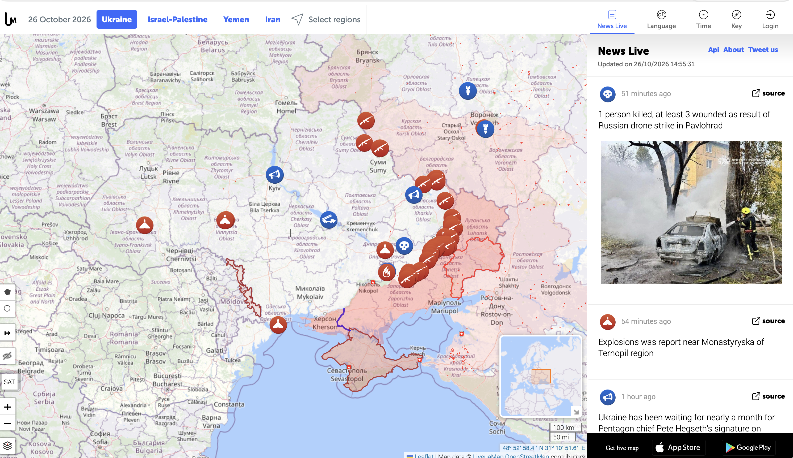

# LiveUAMap

## URL

[https://liveuamap.com/](https://liveuamap.com/)

## Description

LiveUAMap is a tool that provides updates on global geopolitical events, conflicts, and crises. Using an interactive map interface, the platform allows users to gain insights into various incidents happening worldwide. It gathers information from open sources, including news outlets and social media. Automated web crawlers identify potentially newsworthy stories, which are then fact-checked by analysts, and editors decide what is published on the map.

One of the key features of LiveUAMap is its ability to display a wide range of events, including but not limited to military actions, protests, government decisions, and natural disasters. Users can filter events by type and date, and switch between more than 30 regional maps, which makes it easier to track developments of particular interest or concern.

### Features:

* **Coverage:** global coverage with dedicated regional maps across [30+ regions](https://liveuamap.com/about), including Ukraine, Israel-Palestine, Syria, Venezuela, Libya, Asia, and other conflict areas.
* **Language:** available languages vary by regional map, often including local languages. For example, the main map offers English, Turkish, Spanish, Ukrainian, Russian, French, German and Arabic, while the Iran map also includes Persian, Kurdish and Hebrew. When a language is selected, the menus and news items are translated, with only small portions remaining in English.
* **Polygons:** allows users to draw shareable polygons to select specific areas.
* **Measure distance:** measure distance between points in feet and metres.
* **History:** limited access to past events on the free plan; earlier history is available with the Ad-free and Pro plans.
* **News feed:** allows you to jump to locations on the map or to see news events for locations on the map (all news items include sources).
* **Time:** filter by date.
* **Filter:** Incidents include road accidents, drones/robots, explosions/blasts, police, animals, etc.

### Paid Plans:

* **Ad-free:** removes advertising and unlocks earlier history and all regions.
* **Pro:** includes everything in Ad-free, plus all events (some are only shown in paid feeds), satellite maps from Google Maps and Mapbox, location search, custom region sets and data export.

**Liveuamap** is available in the following formats:

* Web: accessible through any web browser, providing full access to the map and all features.
* Mobile: available as a mobile app for both iOS and Android.

The screenshot below shows events including shelling, armed conflict, anti-air surface-to-air missile launches for the current day (in this case 26th of October 2026):

<figure><figcaption>
LiveUAMap screenshot showing real-time updates of military incidents and air defense activity in Ukraine and surrounding regions on October 26 2026.
</figcaption></figure>

### Use Cases

Open source researchers can find LiveUAMap to be a helpful resource for their investigations and analyses. Here are some specific ways in which they might use the tool:

1. **Conflict Analysis and Monitoring**: By tracking the progression of conflicts, researchers can document changes, analyze the dynamics of conflicts, and understand geopolitical implications.
2. **Historical Data Compilation:** Using earlier event history (available with the Ad-free and Pro plans) and satellite maps (Pro only), researchers can compare current events with past data to identify patterns or shifts in regional dynamics.
3. **Verification of Reports and Incidents**: Using LiveUAMap, researchers can cross-reference reported events with updates to verify the authenticity and accuracy of information circulating in other media or reports.
4. **Mapping Influence and Control**: The tool allows for tracking territorial control shifts, which can be crucial for understanding the extent of influence and operational capacities of different actors in a conflict zone.
5. **Geopolitical Research**: For studies focusing on geopolitical implications, LiveUAMap offers a visual and interactive means to monitor and analyze the influence of different global and regional powers in specific areas.
6. **Educational Purposes**: Open source researchers can use LiveUAMap as a teaching tool to illustrate the dynamics of global events, conflict zones, or geopolitical changes to students or other audiences.

## Cost

* [ ] Free
* [x] Partially Free
* [ ] Paid

- **Ad-free:** $9.54 per half-year
- **Pro:** from $7 per month ([plans](https://me.liveuamap.com/))
- [API access is charged separately](https://liveuamap.com/promo/api): the Pro plan costs $150/month (200 requests/day, all regions, GeoJSON format, email support); the Enterprise plan starts at $1,000/month (1,500 requests/day, custom areas of interest, local languages, additional social media sources, priority support). Discounts are offered for multiple licences.

## Level of difficulty

<table><thead><tr><th data-type="rating" data-max="5"></th></tr></thead><tbody><tr><td>1</td></tr></tbody></table>

## Requirements

* **Web:** any modern web browser (Chrome, Firefox, Safari, Edge, etc.).
* **Pro Version**: an email address is required to access the Pro features.

## Limitations

LiveUAMap.com, while a valuable resource for learning about geopolitical and conflict-related events, has several limitations, including:

* **Data Reliability**: The information is compiled from various sources, which can vary in reliability and perspective, making it essential to cross-reference facts.
* **Limited Historical Data:** free users have limited access to past events; earlier history requires a paid plan (Ad-free or Pro).
* **Geographical Coverage**: Although extensive, coverage might be uneven, with more focus on active conflict zones, potentially overlooking lesser-reported areas.
* **Incomplete free coverage:** free users cannot access all regions, and some events are only shown to Pro subscribers, with more available via the API. Satellite maps and data export also require Pro.
* **Mobile app quality:** user reviews on both the App Store and Google Play frequently report performance issues and intrusive advertising in the mobile app. At the time of writing, it was rated 3.3/5 on [Google Play](https://play.google.com/store/apps/details?id=com.altwork.liveuamap) (accessed October 2026), with recurring complaints about freezing, ads that can’t be closed, and feed updates lagging by hours. The web version is recommended for investigative use.

## Similar Tools

Liveuamap is one of several tools available for monitoring conflicts and geopolitical events in near real-time. The tools below offer overlapping functionality and may be worth consulting alongside Liveuamap, depending on the scope and nature of your research.

| Tool                                                                                    | Description                                                                                          | Similarities                                                  | Differences                                                                                                                |
| --------------------------------------------------------------------------------------- | ---------------------------------------------------------------------------------------------------- | ------------------------------------------------------------- | -------------------------------------------------------------------------------------------------------------------------- |
| [ACLED](https://bellingcat.gitbook.io/toolkit/more/all-tools/acled)                     | Armed Conflict Location & Event Data Project - tracks conflict events globally with structured data. | Both cover armed conflicts and geopolitical events worldwide. | ACLED focuses on structured, downloadable datasets for deeper analysis; Liveuamap is map-first and real-time               |
| [UNOSAT Analyses](https://bellingcat.gitbook.io/toolkit/more/all-tools/unosat-analyses) | UN satellite analysis for crisis areas, including damage assessments.                                | Both are used for monitoring and documenting crisis zones.    | UNOSAT provides satellite-based damage assessments as static reports; Liveuamap offers continuous real-time event tracking |
| [NASA FIRMS](https://bellingcat.gitbook.io/toolkit/more/all-tools/nasa-firms)           | Near real-time satellite fire detection mapped globally.                                             | Both show near real-time events on an interactive global map. | FIRMS is limited to fire and thermal anomaly data; Liveuamap covers a broad range of conflict and crisis event types.      |

## Ethical Considerations

When using [LiveUAMap.com](https://liveuamap.com/), users should be mindful of several ethical considerations:

* **Source Transparency**: It is essential to clearly cite sources and understand their reliability and potential biases. This ensures the credibility of the information being presented.
* **Privacy and Security**: In conflict zones, the dissemination of certain information could pose risks to individuals' safety and security. It's crucial to balance the public's right to know with the potential harm that information could cause.
* **Information Accuracy**: Given the fast-paced nature of updates and the reliance on a variety of sources, there's a responsibility to verify information before disseminating it to prevent the spread of misinformation.
* **Bias and Perspective:** Information should be presented as impartially as possible, taking into account the perspectives and potential biases of the original sources.
* **Independence:** Liveuamap describes itself as a non-governmental organisation but states that it cooperates with multiple governments and provides them with data. Researchers should take this into account when assessing potential bias ([About](https://liveuamap.com/about)).
* **Attribution:** Liveuamap’s data and maps may be reused with a reference to liveuamap.com, while images and text from third-party social networks remain subject to the terms of their original platforms ([Terms of Use](https://liveuamap.com/about#terms)).

## Guide

To effectively use Liveuamap, especially for beginners or those looking to refine their skills, the following resources are highly recommended:

**Official Wiki**

* [https://liveuamap.com/about](https://liveuamap.com/about)

**Tutorials and Articles**

* ‘Mapping Territorial Control and Contestation in Syria’ (no date) _ACLED_. Available at: [https://acleddata.com/knowledge-base/mapping-territorial-control-contestation-and-activity-in-syria/](https://acleddata.com/knowledge-base/mapping-territorial-control-contestation-and-activity-in-syria/) (Accessed: 26 October 2026).
* Team, B.I. (2017) _Tanks of Buhaivka: A training facility in Eastern Ukraine_, Bellingcat. Available at: [https://www.bellingcat.com/news/uk-and-europe/2017/03/17/tanks-buhaivka-training-facility-eastern-ukraine/](https://www.bellingcat.com/news/uk-and-europe/2017/03/17/tanks-buhaivka-training-facility-eastern-ukraine/) (Accessed: 26 October 2026).
* Zwijnenburg, W. (2020) _Yemen’s Disappearing Date Palms: Applied Environmental OSINT_, Bellingcat. Available at: [https://www.bellingcat.com/news/mena/2020/07/24/yemens-disappearing-date-palms-applied-environmental-osint/](https://www.bellingcat.com/news/mena/2020/07/24/yemens-disappearing-date-palms-applied-environmental-osint/) (Accessed: 26 October 2026).

**Video Tutorials**

* [https://www.youtube.com/@LiveMap](https://www.youtube.com/@LiveMap)
* _Liveuamap - Creating own map_ (2018). Available at: [https://www.youtube.com/watch?v=SDZS1-yysx8](https://www.youtube.com/watch?v=SDZS1-yysx8) (Accessed: 26 October 2026).
* _Liveuamap API and KML (GeoJSON) export_ (2018). Available at: [https://www.youtube.com/watch?v=Ee4TkyHpMIk](https://www.youtube.com/watch?v=Ee4TkyHpMIk) (Accessed: 26 October 2026).
* _Liveuamap HOW TO: selecting optional categories at website_ (2017). Available at: [https://www.youtube.com/watch?v=oTlHyS4gxPQ](https://www.youtube.com/watch?v=oTlHyS4gxPQ) (Accessed: 26 October 2026).
* _LiveUAMap – animated conflict map (Ukraine), 2025._ Available at: [https://www.youtube.com/watch?v=XSGwxw2LnNw](https://www.youtube.com/watch?v=XSGwxw2LnNw) (Accessed: 26 October 2026).

#### Developer Resources

* [https://liveuamap.com/promo/api](https://liveuamap.com/promo/api)

**Community and Support**

* [https://www.facebook.com/liveuamap](https://www.facebook.com/liveuamap) (see: [https://liveuamap.com/about#socmedia](https://liveuamap.com/about#socmedia) for full list)

**Official Blog**

* [https://blog.liveuamap.com](https://blog.liveuamap.com)

## Tool provider

Liveuamap LLC, registered in the State of Virginia, USA (McLean, VA). The service runs on EU-based technical infrastructure. Founded in 2014 by Rodion Rozhkovsky and Alexander Bil’chenko. [https://liveuamap.com/about](https://liveuamap.com/about) .&#x20;

## Advertising Trackers

* [ ] This tool has not been checked for advertising trackers yet.
* [x] This tool uses tracking cookies. Use with caution.
* [ ] This tool does not appear to use tracking cookies.

According to its privacy policy, Liveuamap is mainly funded by advertising and uses third-party advertising companies that set cookies ([https://liveuamap.com/about#privacy](https://liveuamap.com/about#privacy)).

| Page maintainer      |
| -------------------- |
| Tsvetelina Yordanova |
|                      |
