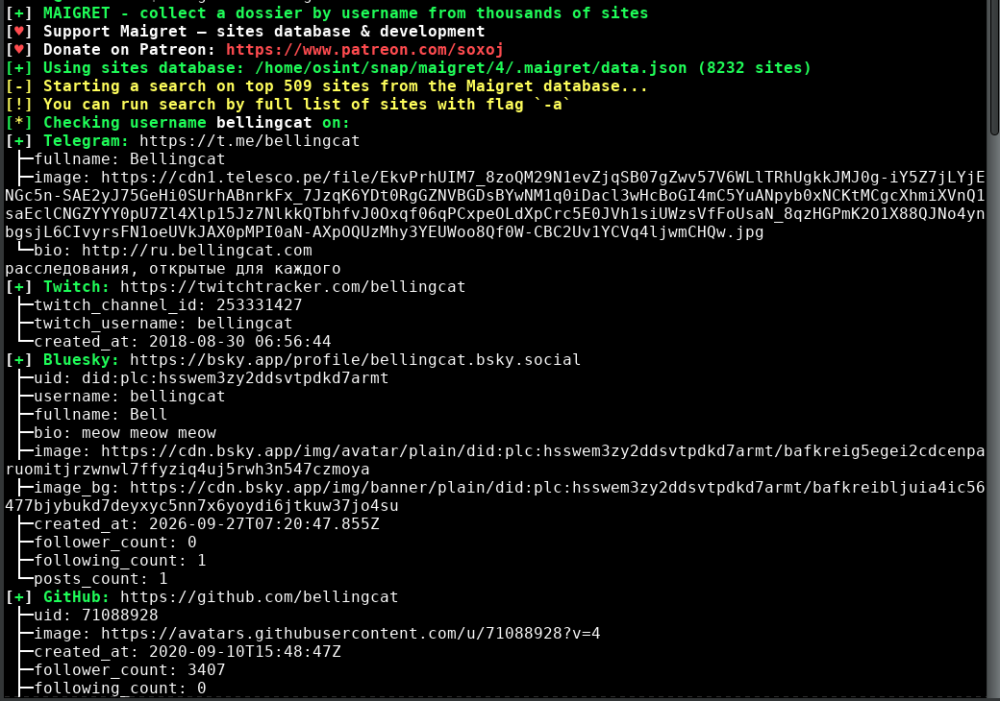
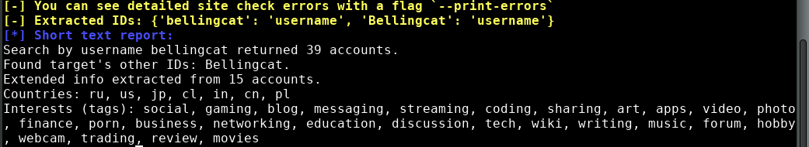
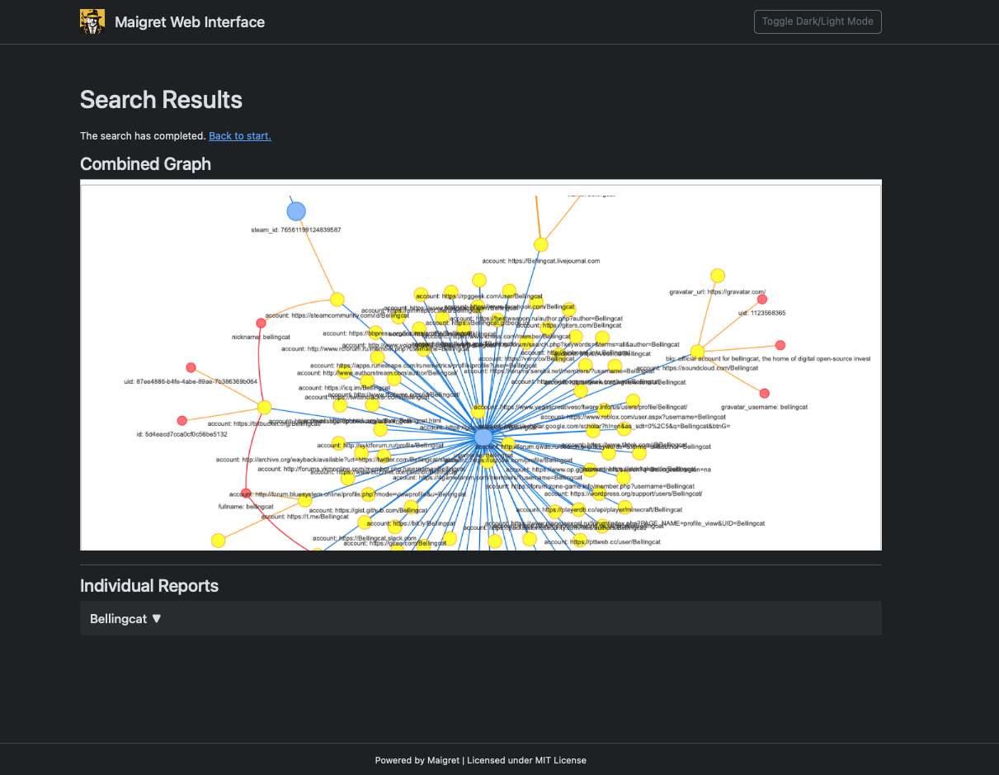

# Maigret

## URL

[https://github.com/soxoj/maigret](https://github.com/soxoj/maigret)

## Description

Maigret is a command-line tool that collects information about a person using their username. It checks for accounts across over over 5,000 sites (5,203 enabled as of [v0.6.6](https://github.com/soxoj/maigret/blob/main/CHANGELOG.md), September 2026), gathering available information directly from web pages, without the need for API keys. The tool itself is a fork of the [Sherlock project](https://bellingcat.gitbook.io/toolkit/more/all-tools/sherlock).

Coverage has recently expanded beyond primarily Western platforms - the [v0.6.4 release](https://github.com/soxoj/maigret/releases/tag/v0.6.4) added support for Chinese platforms including QQ (via a dedicated `qq_id` identifier) and Bilibili. The latest release, [v0.6.6](https://github.com/soxoj/maigret/blob/main/CHANGELOG.md) (September 2026), doubled the site database and added the `--input-file` option, which reads usernames or other identifiers from a file, one per line, instead of typing them all on the command line.

If not explicitly specified with a tag, Maigret will start its search with the top 500 sites from its database, including many popular social platforms. Users have the option to expand the search by including different options, ranging from specific sites to countries and identifiers.

Identifiers refer to unique markers associated with user accounts on specific platforms, such as a **gaia\_id** (Google's internal numeric user identifier, previously found in Google Plus accounts) or other similar unique attributes. These allow Maigret to conduct more targeted and precise searches beyond ordinary usernames.

<figure><figcaption><p>Maigret search for the username “bellingcat” (Snap version, October 2026). Note the Bluesky result: the account shares the username but is unrelated to Bellingcat, showing why every match needs manual verification.</p></figcaption></figure>

To start a simple search on Maigret, all you need to do is provide one or more usernames for the individual you want to investigate. For example, searching for "bellingcat" will check if that username exists across the platforms supported by the tool (like social networks, forums, blogs and more). If an account is found, a report detailing where the username appears will be generated. This includes links to profile pages or relevant content on those platforms (e.g., Facebook, Instagram etc) and any available additional metadata like account creation dates or follower counts, if retrievable. In this case of "bellingcat," we discovered accounts on Telegram, Instagram, Github, TikTok and GithubGist.

In addition, Maigret scans account webpages (username bellingcat on X will return -[https://x.com/bellingcat](https://x.com/bellingcat)) to extract personal details and links to other profiles, displaying this information in the command line output and including it in reports. It also uses found IDs and usernames to start new searches automatically.

The tool supports generating reports in various formats, including HTML, PDF, TXT, XMind 8 mindmap, JSON, [Markdown](https://github.com/soxoj/maigret/blob/main/CHANGELOG.md) (useful for feeding results into LLM-based analysis), and [Neo4j Cypher export](https://github.com/soxoj/maigret/blob/main/CHANGELOG.md) (for loading results into a graph database for network analysis).

A short text report is also shown in the command line after the search phase.

<figure><figcaption><p>The short text report at the end of a search. The “Interests” and “Countries” lines are derived from the tags of the sites where the username was found, not from the account owner’s actual interests or location.</p></figcaption></figure>

## Cost

* [x] Free
* [ ] Partially Free
* [ ] Paid

## Level of difficulty

<table><thead><tr><th data-type="rating" data-max="5"></th></tr></thead><tbody><tr><td>3</td></tr></tbody></table>

## Requirements

* Python 3.10 or higher for pip, pipx or source installations. The Windows EXE, the Snap package, Docker and the Telegram bot don’t require Python. A Telegram account is needed only for the Telegram bot.

## Installation and usage

**Windows:** download `maigret_standalone.exe` from the [Releases](https://github.com/soxoj/maigret/releases) page. Since v0.6.6, the EXE is attached to each release directly.

Telegram bot: [@maigret\_search\_protection\_bot](https://t.me/maigret_search_protection_bot), described in the README as a community bot, runs Maigret searches directly in Telegram without installing anything.

<figure><figcaption><p>The Maigret Telegram bot, linked from the project’s README (October 2026).</p></figcaption></figure>

If you wish to use the tool without installation, it can also be launched from cloud shells and Jupyter notebooks. This allows you to run it directly in your browser. You can follow the provided instructions to launch Maigret in your browser, with options to open it in [Google Cloud Shell,](https://shell.cloud.google.com/) run it on [Replit](https://replit.com), open it in Colab, or launch it via [Binder](https://mybinder.org).

For local installation, you can use pip3, Docker, or clone the GitHub repository.

**To install from PyPl:**

```python
// pip3 install maigret
```

**Snap and pipx**

Snap (Linux, amd64 and arm64, no Python required): The Snap version can only write files inside your home directory, so run it from there.

```python
// sudo snap install maigret
```

Pipx installation:

```python
// pipx install maigret
```

**Using Docker:**

```python
// docker pull soxoj/maigret 
// docker run soxoj/maigret <username>
```

For the web interface, use the separate web image:

```
docker run -p 5000:5000 soxoj/maigret:web
```

Then open `http://127.0.0.1:5000` in your browser.

**Cloning the repository:**

```python
// git clone https://github.com/soxoj/maigret && cd maigret
pip3 install .
```

To search for accounts with specific username, use:

```python
// maigret <username>
```

For more detailed searches, you can add options like '-a' to search all sites, or '-o' to save the output to a specific file format, such as HTML or PDF. Maigret also supports multiple usernames in a single search by listing them together: maigret \<username1> \<username2> .

You can also create advanced queries using built-in categories, boolean operators, and substring matches for source names.

For example, you can search for all accounts that have the username 'bellingcat' on websites categorized as 'social':"

```python
// maigret --filter "cat=social" --username bellingcat
```

**Web Interface:**

Maigret also offers a web interface that makes it easier to interact with search results. To use the web interface, you need to use the --web flag and specify a port number.

For example, to run the web interface on port 5000, use:

```
// maigret --web 5000
```

Once Maigret is running with the web interface, open your browser and go to http://127.0.0.1:5000.

Here, you can enter one or more usernames to initiate a search. After the search is complete, the web interface will display a graphical representation of the results, a table with all the accounts found, and provide options to download the reports in multiple formats (HTML, PDF, etc.).

<figure><figcaption><p>Maigret Web Interface displays search results for the username “Bellingcat,” with a combined graph of linked accounts and individual report options.</p></figcaption></figure>

More recent releases have also added live scan progress, persistent settings, search history, and Cloudflare bypass options to the [web interface](https://github.com/soxoj/maigret/blob/main/CHANGELOG.md).

As of v0.6.0, Maigret includes an optional AI analysis mode that generates a short investigation summary from search results using an OpenAI-compatible API. To enable it, add the --ai flag:

```
// maigret bellingcat --ai
```

## Limitations and Ethical Considerations

* **Bot protection and CAPTCHAs:** Some sites block automated requests or show CAPTCHAs, which can lead to incomplete results. Maigret can route checks through a proxy, Tor or I2P, and offers an experimental [Cloudflare bypass](https://maigret.readthedocs.io/en/latest/features.html#cloudflare-bypass) (`--cloudflare-bypass`) that uses a locally running FlareSolverr instance. The developer describe this feature as experimental and subject to change. Running Maigret from cloud or data-centre servers (e.g. GitHub Codespaces, Google Cloud Shell) may also produce more blocked results, as some sites block data-centre IP addresses.
* **Matches are not identity confirmation:** Maigret only checks whether an account with the same username exists on a site, not who owns it. In a test search for “bellingcat” (October 2026), the results included a Bluesky account with the same username that is unrelated to Bellingcat. Each result needs to be verified manually before it is attributed to a person or organisation. The “Interests” and “Countries” lines in the summary report are derived from the tags of the sites where the username was found, not from the account owner’s actual interests or location.
* **Frequent updates:** Maigret is actively maintained, with five releases between July and September 2026 ([changelog](https://github.com/soxoj/maigret/blob/main/CHANGELOG.md)). v0.6.2 (1 July), v0.6.3 (13 July) and v0.6.4 (11 August) fixed false positives and security issues, including SSRF and path traversal vulnerabilities. v0.6.5 (25 August) fixed searches failing on read-only installations such as Snap and Docker, and v0.6.6 (18 September) doubled the site database. Because site checks change often, keeping Maigret up to date reduces false positives.
* **Sensitive platforms:** Since v0.6.1, Maigret also checks OnlyFans and similar adult platforms. A match on such a site can be a sensitive disclosure about a person and should be handled with particular care, especially if it is unverified.
* **AI mode sends data to a third party:** Maigret itself runs locally, without telemetry or analytics ([privacy page](https://maigret.readthedocs.io/en/latest/privacy.html)). The optional AI mode (`--ai`), however, sends the search report to the OpenAI API, or to another OpenAI-compatible service configured in the settings. For sensitive investigations, avoid AI mode or point it to a locally hosted model.
* **Telegram bot privacy:** Searches made through the Telegram bot are processed on a third-party server and linked to your Telegram account. For sensitive investigations, run Maigret locally instead.
* **Legal and ethical use:** Users are responsible for verifying findings and for complying with the laws that apply in their jurisdiction, including data protection rules such as the GDPR.

## Similar Tools

While Maigret is designed for in-depth username enumeration and verification, other solutions offer overlapping functionality with different levels of depth, speed, and platform coverage. Some are better suited for quick checks or initial triage, while others focus on identifying the presence of usernames across a more limited set of platforms.

In practice, these options may be used alongside Maigret or as preliminary steps before conducting more exhaustive username enumeration.

* [**Namechk**](https://bellingcat.gitbook.io/toolkit/more/all-tools/namechk) **:** a web-based service for checking the availability of usernames and domain names across popular platforms. It allows investigators to quickly determine whether a specific username is already in use on well-known social media services or registered as a domain. Namechk is most useful for rapid initial checks and does not verify whether an account is actively used or linked to a specific individual.
* [What’s My Name](https://bellingcat.gitbook.io/toolkit/more/all-tools/whats-my-name) : a browser-based username checker that searches for a given username across multiple online platforms and returns links to accounts where the username appears to exist. It provides a straightforward way to identify potential matches on commonly used services without requiring local setup. This approach is best suited for quick cross-platform checks rather than detailed or large-scale enumeration.
* [Blackbird](https://bellingcat.gitbook.io/toolkit/more/all-tools/blackbird) : an open source research utility for identifying the presence of a username across a wide range of social media platforms and online services. Blackbird can be used via both a command-line interface and a web-based interface, depending on the deployment and use case. Results include direct links to detected profiles, but additional verification is recommended to confirm relevance.
* [Sherlock](https://bellingcat.gitbook.io/toolkit/more/all-tools/sherlock) : an open-source, command-line application that searches for usernames across many social networks and online platforms. It supports local execution and automation, making it suitable for repeatable or scriptable open source research workflows. As with other enumeration approaches, results should be reviewed carefully to account for false positives or platform changes.
* [Skopenow](https://bellingcat.gitbook.io/toolkit/more/all-tools/skopenow) : a commercial open source research platform designed for automated people search, social media profiling, and digital footprint analysis. It aggregates data from multiple online sources and presents findings through a web-based interface. Skopenow is typically used in professional or institutional contexts and differs from open-source options in terms of access, cost, and methodology.

## Guides and articles

* Documentation: [https://maigret.readthedocs.io/en/latest/index.html](https://maigret.readthedocs.io/en/latest/index.html)
* GitHub repo and instruction for installation: [https://github.com/soxoj/maigret](https://github.com/soxoj/maigret)
* Youtube video for Windows installation and usage: [https://www.youtube.com/watch?v=qIgwTZOmMmM](https://www.youtube.com/watch?v=qIgwTZOmMmM)
* Changelog with all releases: [https://github.com/soxoj/maigret/blob/main/CHANGELOG.md](https://github.com/soxoj/maigret/blob/main/CHANGELOG.md)
* Privacy page: [https://maigret.readthedocs.io/en/latest/privacy.html](https://maigret.readthedocs.io/en/latest/privacy.html)
* French documentation (since v0.6.6): [https://maigret.readthedocs.io/fr/latest/](https://maigret.readthedocs.io/fr/latest/)

## Tool provider

The tool provider of Maigret is [Dmitry Danilov](https://www.linkedin.com/in/danilov-d/), Netherlands.

## Advertising Trackers

* [x] This tool has not been checked for advertising trackers yet.
* [ ] This tool uses tracking cookies. Use with caution.
* [ ] This tool does not appear to use tracking cookies.

Maigret runs locally and, according to its [privacy page](https://maigret.readthedocs.io/en/latest/privacy.html), has no telemetry or analytics and sends nothing to the developers. Usernames are sent only to the sites being checked.

| Paige Maintainer     |
| -------------------- |
| Tsvetelina Yordanova |
