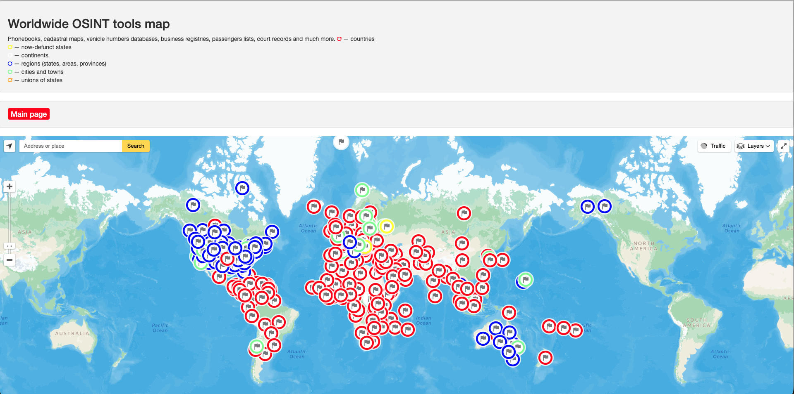
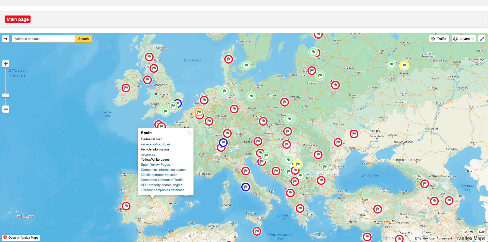

# OSINT Tools Map

## URL

[https://cybdetective.com/osintmap/](https://cybdetective.com/osintmap/)

## Description

The OSINT Tools Map is an interactive map created by Cyber Detective that lists open-source intelligence (OSINT) resources from around the world. Each country entry contains links to official and unofficial data sources such as business registries, land cadastres, court databases, phone directories, and media archives. Its structured layout allows users to quickly locate national or regional information sources, making it a valuable starting point for investigators researching unfamiliar countries or sectors.

The map offers a wide range of tools that draw from various public records and datasets. These include cadastral maps (which, depending on the country, may or may not show ownership details), business registries for company information, yellow pages for local listings, and court databases that can be essential for legal and investigative work.

Although the depth of information varies by country - with some offering more extensive data than others - the OSINT Tools Map still provides a broad and practical entry point for users, even when exploring regions with limited digital transparency.

<figure><figcaption>
OSINT Tools Map, showing global coverage of resources by country(October 2026)
</figcaption></figure>

To start using the OSINT Tools Map, click directly on the map to explore specific countries, cities, or regions, or use the search bar to quickly find the location you are interested in. Additionally, the platform offers a list of countries, cities, territories, and services, which can be accessed by scrolling down, providing an alternative way to navigate through the various available resources.

For example, the entry for Spain links to a range of national resources:

* **Cadastral map:** sedecatastro.gob.es is the Sede Electrónica del Catastro (SEC), the online portal of Spain’s Directorate General for the Cadastre. Non-protected cadastral data, including cadastral maps and property descriptions, can be consulted freely, while the owner’s name, tax ID, address and the cadastral value are protected data, accessible only to the owner or authorised users ([BOE](https://boe.es/boe/dias/2008/12/08/pdfs/A49013-49017.pdf); [Defensor del Pueblo](https://www.defensordelpueblo.es/resoluciones/mantenimiento-de-base-de-datos-catastral-sin-que-se-comuniquen-datos-identificativos-a-terceros)). The map’s “SEC property search engine” link points to the same portal’s property search.
* **Vehicle information:** the Directorate General of Traffic (DGT) issues vehicle reports by number plate from Spain’s national vehicle register, for a fee. Depending on the type, they can include technical data, the number of previous owners, the inspection (ITV) expiry date and any liens on the vehicle ([coches.com](https://noticias.coches.com/consejos/tipos-informe-de-vehiculo-dgt/296875)). The map also lists oscaro.es under vehicle information.
* **Companies:** the Librebor companies database is built on the BORME, the Official Gazette of the Spanish Companies Register, and lets users search companies and their officers by name. The entry also links to a separate companies information search.
* **Other resources:** the Spain Yellow Pages for business listings, and a mobile operator detector for identifying the network a phone number belongs to.

<figure><figcaption>
Spain OSINT resources page(October 2026)
</figcaption></figure>

## Features

* **Interactive map:** navigate visually by country and region.
* **Categorized sources:** includes business registries, cadastral maps, vehicle databases, phonebooks, court records, and local archives.
* **Updates:** new data sources have been added historically, though the frequency of recent updates is uncertain.
* **Direct access:** each entry links directly to third-party public data sites (availability may vary by country).
* **Simple interface:** lightweight, browser-based map that requires no registration or login.
* **Colour-coded markers:** red for countries, yellow for now-defunct states, white for continents, blue for regions (states, areas, provinces), green for cities and towns, and orange for unions of states.

## Cost

* [x] Free
* [ ] Partially Free
* [ ] Paid

## Level of difficulty

<table><thead><tr><th data-type="rating" data-max="5"></th></tr></thead><tbody><tr><td>1</td></tr></tbody></table>

## Requirements

* The OSINT Tools Map is fully web-based and can be accessed using any modern browser (e.g., Chrome, Firefox, Edge, Safari) on desktop or mobile devices.

## Limitations

While the OSINT Tools Map functions as a practical archive of links to external resources, researchers should be aware of the following limitations:

* **Maintenance status:** The map was moved to its own domain in September 2023, when it listed 690+ tools across 160+ countries and 90+ cities and regions ([Cyber Detective newsletter](https://cybdetective.substack.com/p/cyber-detective-osint-tools-newsletter-546)). The creator reported further growth to 747+ links in February 2024 ([X post](https://x.com/cyb_detective/status/1760675164050915634)). No more recent updates have been confirmed, and there is no changelog or per-entry “last verified” date, so individual links may be outdated.
* **Broken links:** some linked sources may be temporarily or permanently unavailable; for example, some Spanish government links returned server errors when tested in October 2026.
* **No direct data access:** The map links to external sources rather than containing data itself. Linked sources may change, move, or become unavailable over time.
* **Variable coverage:** Availability and depth of resources varies significantly by country, and researchers should verify the current status of any linked source before relying on it.

## Ethical Considerations

Researchers should be mindful of local privacy laws, access restrictions, and ethical standards when using resources linked through the OSINT Tools Map. Many listed sources provide access to public records or personal data that may be subject to jurisdiction-specific legal or ethical constraints. Information obtained through these sources should be used responsibly and in accordance with applicable laws, particularly when handling personal or sensitive data.

Because the map is built on Yandex Maps, loading it sends browsing data to Yandex. Researchers with strict OPSEC requirements may prefer to use the plain list of links in the project’s [GitHub repository](https://github.com/cipher387/osintmap).

## Guide and articles

* GitHub repository, including a searchable text list of all countries and links: [https://github.com/cipher387/osintmap](https://github.com/cipher387/osintmap).

## Tool provider

Created and maintained by Cyber Detective ([@cyb\_detective](https://x.com/cyb_detective)), an independent OSINT researcher. Website: [https://cybdetective.com/](https://cybdetective.com/).

## Advertising Trackers

* [x] This tool has not been checked for advertising trackers yet.
* [ ] This tool uses tracking cookies. Use with caution.
* [ ] This tool does not appear to use tracking cookies.

| Page maintainer      |
| -------------------- |
| Tsvetelina Yordanova |
|                      |
