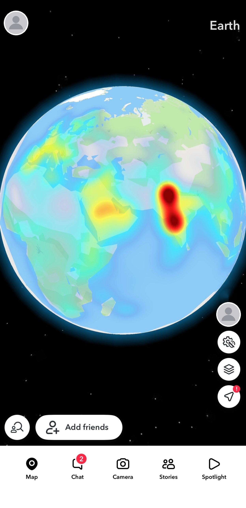
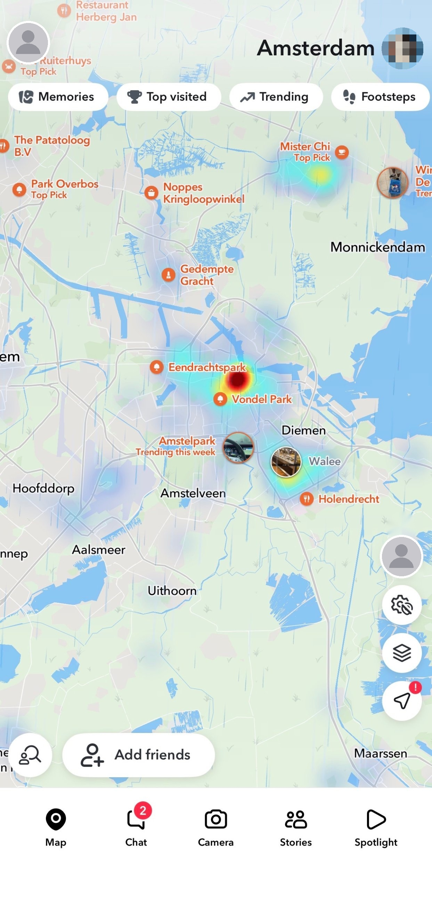
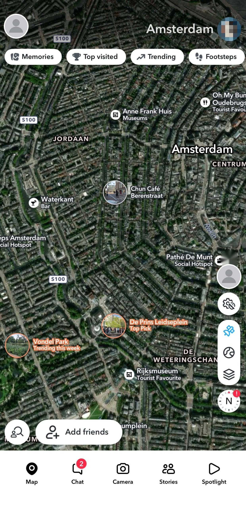
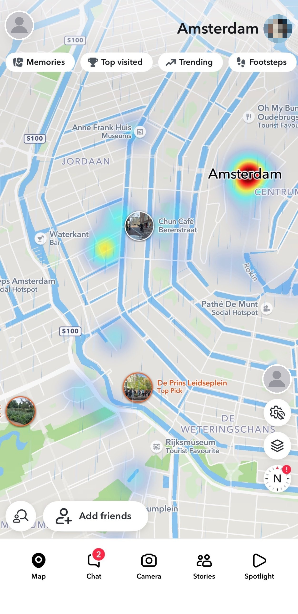
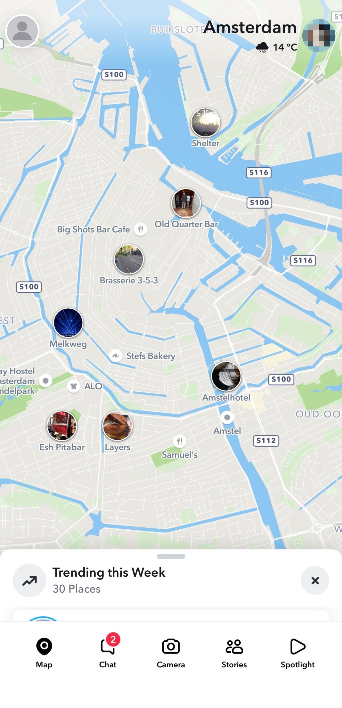

# Snap Map

## URL

Snap Map is available only within the Snapchat mobile app (iOS/Android). The former web version at map.snapchat.com now redirects to snapchat.com.

## Description

<figure><figcaption>
Global view in Snap Map, showing current posting activity concentrated over India and the Arabian Peninsula.
</figcaption></figure> <figure><figcaption>
Regional view around Amsterdam: heat clusters show where posting activity is concentrated, alongside labelled place markers and public Snap thumbnails.
</figcaption></figure>

Snap Map is a feature within [Snapchat](https://www.snapchat.com/) that displays publicly shared Snaps on an interactive map. When a user posts a Story to "Our Story", Snapchat geotags that content so it appears as a hotspot on the map. The intensity of the hotspot reflects posting volume - warmer colours indicate higher activity. Taping a hotspot opens the associated public Snaps for that location.

Snap Map is only accessible via the Snapchat mobile app; the former web version at map.snapchat.com now redirects to the Snapchat homepage. The app supports keyword search, zoom-based exploration, and browsing of user-generated photos and videos. Filter tabs at the top of the map - Memories, Top visited, Trending and Footsteps (locations the user has previously visited) - sit alongside place markers labelled, for example, Top Pick, Trending this week, Social Hotspot or Tourist Favourite. [Promoted Places](https://newsroom.snap.com/2025-snap-map-mau) (commercially sponsored business locations, introduced alongside Snap Map surpassing 400 million monthly active users in 2025) appear among these markers. Investigators should be aware that Promoted Places can inflate apparent activity in commercial areas.

For open source research purposes, Snap Map is most useful for monitoring real-time situations - protests, natural disasters, armed conflict, or large public gatherings - by accessing short clips posted by people on the ground. It has been used by investigators and journalists to gather firsthand visual evidence from areas that are otherwise difficult to access, including during the [2023 conflict in Gaza](https://techcrunch.com/2023/11/03/snapchat-snap-map-israel-hamas-war-gaza-palestine/).

Each public Snap on the map is linked to the Snapchat account that posted it. Clicking through to a post allows investigators to view the poster's public profile, which may include their username, bio, and other publicly visible content - making Snap Map a useful entry point for human network investigations tied to a specific location.

Certain venues such as museums, universities, and restaurants are automatically surfaced on the map. Users can also create Geo Stories, allowing multiple people in the same area to contribute to a shared location-tagged story - these can be particularly valuable for monitoring localised events with multiple contributors.

### Map and satellite view

Snap Map shows the heatmap and individual content together, and what appears depends on the zoom level: at global or regional scale, activity is aggregated into colour-coded zones; zoomed in to street level, individual Snaps appear as circular thumbnails next to named places.

At street level, the map can also be switched to satellite imagery using the controls on the right-hand side. The images below show the same part of central Amsterdam in both views. In the standard view, a heat cluster sits around the city centre, and markers identify places such as the Rijksmuseum (Tourist Favourite), Anne Frank Huis (Museums), and a Top Pick at Leidseplein. The satellite view keeps the same Snaps and markers but shows the physical surroundings, which can help when comparing a post with the location it is tagged to.

<figure><figcaption>
Satellite view of central Amsterdam, useful for comparing posts with their physical surroundings.
</figcaption></figure> <figure><figcaption>
The same area in standard map view, with a heat cluster around the city centre and labelled place markers.
</figcaption></figure>

## How to use

1. Open Snap Map in the Snapchat app by tapping **Map**, the first icon in the bottom navigation bar.
2. Orient yourself at global or regional scale first - warmer colour clusters indicate areas of higher posting activity. This is useful for identifying where content is concentrated before zooming in.
3. Zoom into an area of interest. Individual Snaps and place markers will appear, labelled for example as Top Pick, Trending this week, Social Hotspot or Tourist Favourite.
4. Use the filter tabs at the top of the map. **Trending**, for example, opens a list of places trending this week in the area you are viewing.
5. Filter by keyword using the search bar to narrow results to a specific event, place name, or topic. Note that there is no date or time filter - results reflect recent posts only.
6. Tap a Snap thumbnail or hotspot to view the associated public Snaps for that location. Content appears as short photos or videos posted by users in or near that area.
7. Follow through to the poster’s profile by tapping on an individual Snap. The public profile may include the username, bio, and other publicly visible posts - useful as a starting point for further account investigation.
8. Archive what you find immediately using a screenshot or a third-party archiving tool. Snaps remain on the map only for a limited time and there is no native export function.

<figure><figcaption>
The Trending tab lists places trending this week in the visible area - here, 30 places in central Amsterdam.
</figcaption></figure>

### Cost

* [x] Free
* [ ] Partially Free
* [ ] Paid

## Level of difficulty

<table><thead><tr><th data-type="rating" data-max="5"></th></tr></thead><tbody><tr><td>2</td></tr></tbody></table>

## Requirements

* A Snapchat account with a verified email or phone number. Snap Map is only available in the mobile app.&#x20;

## Limitations

* **Data availability varies:** Content appears only where users have recently posted; rural or restricted areas may be sparse. Snap Map activity broadly reflects Snapchat's [overall user distribution](https://datareportal.com/essential-snapchat-stats), which is largest in India, the US, and parts of the Middle East and Europe.
* **Limited filtering:** Search is keyword-based only. There is no way to sort results by date or time, or to search for content by a specific username.
* **Temporary posts:** Snaps posted to Snap Map may be visible for [varying amounts of time](https://help.snapchat.com/hc/en-us/articles/7012271195796-How-do-I-submit-a-Snap-to-Snap-Map) - from a day or two to potentially much longer. There is no guarantee content will still be available when you return to it. Archive anything relevant immediately.
* **Commercial content mixed with organic posts:** Promoted Places surfaces brand locations and sponsored content directly on the map alongside user-generated Snaps, which can distort activity signals in commercial areas.
* **Possible inaccuracies:** User-generated posts may carry incorrect or spoofed location tags, and content may lack sufficient context to allow researchers to verify the location independently.
* **No built-in archive:** **No built-in archive:** There is no native export or save function. Investigators should capture references - screenshots, URLs, or use of a third-party archiving tool - while viewing, as content may disappear at any time.
* **Country availability:** Snap Map may be restricted in [certain jurisdictions](https://www.aljazeera.com/news/2025/12/5/russia-continues-tech-crackdown-by-blocking-snapchat-facetime-access) and availability is subject to change.
* **Cross-platform gaps:** Snap Map only shows content posted directly to Snapchat's public map - but Snapchat content is frequently reposted to Twitter/X and Instagram by users or aggregators, so a location-based search elsewhere may surface Snapchat-sourced content that never appears on the map itself.

## Similar Tools

The following tools also allow investigators to discover and analyse user-generated, location-tagged content across other platforms:

* [**Instagram Location Search**](https://bellingcat.gitbook.io/toolkit/more/all-tools/instagram-location-search) - searches for geotagged posts on Instagram near specified coordinates, useful for finding user-generated content from a specific location across a different platform.
* [**Strava**](https://bellingcat.gitbook.io/toolkit/more/all-tools/strava) - surfaces user-generated GPS activity tracks publicly shared on the platform, which can reveal movement patterns tied to specific locations.

## Ethical Considerations

* Public Snaps often reveal exact locations, daily routines, and identifiable details about individuals who may not fully understand their content is publicly visible. Investigators should handle this data with care and avoid any use that could enable doxxing or harassment.
* Content from public gatherings, protests, or crisis situations may include minors, people in vulnerable circumstances, or graphic and sensitive material. Exercise particular caution when sharing or publishing such content.
* Ghost Mode prevents friends from seeing a user's location on the map, but Snapchat continues to process location data internally per its [privacy policy](https://values.snap.com/privacy/privacy-policy). Investigators should not assume that a user in Ghost Mode has no location footprint within the platform.

## Guides and articles

* Sung, Morgan: People are turning to Snap Map for firsthand perspectives from Gaza, [https://techcrunch.com/2023/11/03/snapchat-snap-map-israel-hamas-war-gaza-palestine/](https://techcrunch.com/2023/11/03/snapchat-snap-map-israel-hamas-war-gaza-palestine/).
* Citizen Evidence Lab: How to Use Snapchat to Monitor Breaking Events, [https://citizenevidence.org/2019/12/10/how-to-use-snapchat-to-monitor-breaking-events/](https://citizenevidence.org/2019/12/10/how-to-use-snapchat-to-monitor-breaking-events/) .
* Matthews, R. et al: Exploitation of Snapchat's Snap Map as a Surveillance Tool, Forensic Science International: Digital Investigation, 2021, [https://dfrws.org/wp-content/uploads/2021/03/FSIDI301112\_proof.pdf](https://dfrws.org/wp-content/uploads/2021/03/FSIDI301112_proof.pdf) .
* Bradshaw, Paul (interviewed by GIJN): Using Snapchat as an Investigative Tool, Global Investigative Journalism Network, December 2021, at [https://gijn.org/stories/using-snapchat-as-an-investigative-tool-q-a-with-paul-bradshaw/](https://gijn.org/stories/using-snapchat-as-an-investigative-tool-q-a-with-paul-bradshaw/) .

## Tool provider

Snapchat, Snap Inc., USA

## Advertising Trackers

* [ ] This tool has not been checked for advertising trackers yet.
* [x] This tool uses tracking cookies. Use with caution.
* [ ] This tool does not appear to use tracking cookies.

Snap’s [Cookie Policy](https://www.snap.com/cookie-policy) lists Marketing cookies used to deliver ads and measure ad performance, and allows third-party advertising partners to set cookies on its services. In the app, Snap uses device identifiers for interest-based advertising; users can limit this through their device settings and Snapchat’s ad preferences ([Snap and Ads](https://values.snap.com/privacy/ads-privacy)).

| Page maintainer      |
| -------------------- |
| Tsvetelina Yordanova |
